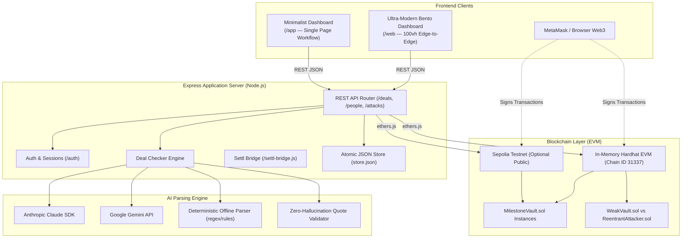

# Settl — Staged Escrow Agreement Engine

> **Turn plain-language agreements into locked, cryptographically verified escrow contracts.**  
> Built for **VORTEXA 3.0**, Problem **B-03 MilestoneVault: Adversarial Smart-Contract Escrow**.

---

## Table of Contents
1. [Executive Summary](#1-executive-summary)
2. [System Architecture](#2-system-architecture)
3. [Backend Deep Dive](#3-backend-deep-dive)
   - [Express API Server & Routes](#express-api-server--routes)
   - [Smart Contract: MilestoneVault.sol](#smart-contract-milestonevaultsol)
   - [AI Deal Checker Engine](#ai-deal-checker-engine)
   - [Hardhat Local Chain & Testnet RPC](#hardhat-local-chain--testnet-rpc)
   - [Security Guarantees & Attack Lab](#security-guarantees--attack-lab)
   - [State Store & Session Authentication](#state-store--session-authentication)
4. [Frontend Deep Dive: Dashboards](#4-frontend-deep-dive-dashboards)
   - [The Ultra-Modern Bento Dashboard (`/web`)](#the-ultra-modern-bento-dashboard-web)
   - [The 5 Bento Cards Breakdown](#the-5-bento-cards-breakdown)
   - [The 5 Application Screens](#the-5-application-screens)
   - [The Minimalist Dashboard (`/app`)](#the-minimalist-dashboard-app)
   - [The Bridge Architecture (`/old`)](#the-bridge-architecture-old)
   - [Design Tokens, Currency & Refusal UX](#design-tokens-currency--refusal-ux)
5. [Context for AI Coding Agents](#5-context-for-ai-coding-agents)
   - [Agent Mission & Role](#agent-mission--role)
   - [Non-Negotiable Architectural Invariants](#non-negotiable-architectural-invariants)
   - [File & Directory Map](#file--directory-map)
   - [Complete REST API Contract](#complete-rest-api-contract)
   - [State Machine & Transitions](#state-machine--transitions)
   - [Testing & Execution Playbook](#testing--execution-playbook)
   - [Common Gotchas & Troubleshooting](#common-gotchas--troubleshooting)

---

## 1. Executive Summary

When work is paid in milestones, both parties face risk: clients fear losing capital before delivery, and workers fear completing tasks without receiving payment. Middlemen introduce hidden costs, vague phrasing causes disputes, and software handling funds cannot tolerate vulnerabilities like re-entrancy or double payouts.

**Settl eliminates counterparty risk** by:
1. **Translating natural language agreements** into unambiguous structured checklists via an AI-powered checker (with deterministic offline fallback).
2. **Locking simulated or testnet funds** into a battle-tested EVM escrow smart contract (`MilestoneVault.sol`).
3. **Releasing payouts incrementally** upon client approval or arbiter (judge) dispute resolution.
4. **Providing high-fidelity dashboard interfaces**: an ultra-modern light-blue Bento Command Center (`/web`) and a streamlined single-page workflow app (`/app`).
5. **Operating entirely with simulated money / test ETH**: zero real money is ever at risk.

---

## 2. System Architecture



---

## 3. Backend Deep Dive

The backend runs on **Node.js 22+** using **Express 4.21**, **Hardhat 2.22**, and **ethers.js 6.13**.

### Express API Server & Routes
Located in `server/src/`, initialized from `server/src/index.js` and assembled in `server/src/app.js`:

- **`index.js`**: Starts the HTTP server (default port `3000`) and the optional wallet JSON-RPC port (`8545`).
- **`app.js`**: Configures middleware, static file serving, wallet auth sessions, deals routes, people routes, attack lab routes, and the `/old` bridge.
- **`deals.js`**: Core business logic for creating drafts, confirming terms, recording member agreements, deploying vaults, handling stage operations (`done`, `approve`, `dispute`, `resolve`), and tracking fund withdrawals.
- **`people.js`**: Manages fictional demo personas (Riya, Kabir, Aman, Priya, Meera, Vikram) and registered Web3 wallet addresses.
- **`chain.js`**: Direct interface to ethers.js and the EVM. Deploys `MilestoneVault.sol`, queries balances, builds unsigned transactions for wallet holders, executes calls for demo personas, and maps Solidity errors to human-readable text.
- **`attacks.js`**: Controls the live Attack Lab scenarios.
- **`rpc.js`**: Proxies JSON-RPC calls for wallets on the local Hardhat chain.

### Smart Contract: `MilestoneVault.sol`
Located in `contracts/MilestoneVault.sol`.
- **Compiler**: Solidity `^0.8.28`, utilizing OpenZeppelin `ReentrancyGuard`.
- **Factoryless Pattern**: The smart contract is not dynamically generated by AI. It is written and audited once. Each deal deploys a fresh instance parameterized by agreement terms.
- **Phases**:
  1. `Funding`: Waiting for payer deposits and optional payee stakes.
  2. `Active`: 100% funded; stages can be worked on and approved.
  3. `Cancelled`: Escrow aborted during `Funding`; deposits and stakes credited back.
  4. `Closed`: All stages released or refunded; remaining stakes returned.
- **Stage States**:
  - `Pending` $\to$ `Completed` (payee marks done)
  - `Completed` $\to$ `Released` (majority payer approval)
  - `Completed` $\to$ `Disputed` (any payer objects)
  - `Disputed` $\to$ `Released` (judge awards payee)
  - `Disputed` $\to$ `Refunded` (judge refunds payers)
- **Mathematical Invariant**:
  $$\text{Vault Balance} = \sum \text{Locked Stages} + \sum \text{Withdrawable Credits}$$
- **Anti-Theft Protections**:
  - Checks-Effects-Interactions pattern: balance cleared before external transfer.
  - `nonReentrant` modifier on all withdrawal paths.
  - Judge can *only* decide between `pay` or `refund`; the judge can **never** divert funds to their own address.

### AI Deal Checker Engine
Located in `server/src/checker/`:
1. **Model Reader (`model.js`)**: Leverages Claude (via Anthropic SDK) or Gemini to extract payers, payee, judge, stages, conditions, amounts, and vague phrases.
2. **Offline Reader (`rules.js`)**: Deterministic pattern matching using regex. Operates with zero network calls and flags anything non-standard as an unclear point.
3. **Validation & Quote Verification (`validate.js`)**: Enforces the **Zero-Hallucination Invariant**: every extracted milestone condition must match a substring from the original text verbatim. Unmatched conditions are discarded.
4. **Scoring Test (`scripts/score.js`)**: Benchmarks extraction accuracy against 8 benchmark contracts in `samples/deals/`.

### Hardhat Local Chain & Testnet RPC
- **Local Mode (`npm start`)**: Uses Hardhat's in-memory EVM. Resets cleanly on restart. Serves JSON-RPC at `/rpc` and `http://localhost:8545`. Pre-funds demo and wallet accounts with 10,000 test ETH ($1\text{ ETH} \equiv ₹1,000$).
- **Testnet Mode (`npm run testnet`)**: Connects to public testnets (e.g. Sepolia) where 1 test ETH is scaled down for faucet limits ($0.000001\text{ ETH} \equiv ₹1,000$). Deals persist in `server/data/testnet.json`.

### Security Guarantees & Attack Lab
Demonstrates security via 4 real-time interactive attack vectors against `MilestoneVault.sol` vs `WeakVault.sol`:
1. **Second Release**: Payee attempts to trigger payment twice on an approved milestone. Refused with HTTP 409 because stage is already `Released`.
2. **Unauthorized Refund**: Payer attempts to trigger a refund without Arbiter judgment. Refused with HTTP 409 (RBAC check fails).
3. **Out-of-Order Approval**: Client attempts to approve a milestone before the provider submitted completion proof. Refused because stage is still `Pending`.
4. **Re-entrancy Exploit**: Attacker contract (`ReentrantAttacker.sol`) repeatedly re-enters `withdraw()` in its fallback function. On `WeakVault.sol`, the entire contract balance is drained; on `MilestoneVault.sol`, `ReentrancyGuard` halts the transaction.

### State Store & Session Authentication
- **Store (`server/src/store.js`)**: Atomic JSON storage (`server/data/store.json`).
- **Authentication (`server/src/auth.js`)**:
  - Demo personas: identified by `{ person: "Riya" }` payload.
  - Wallet personas: cryptographic `personal_sign` signature verification producing bearer session tokens.

---

## 4. Frontend Deep Dive: Dashboards

Settl includes two distinct dashboards catering to different use cases:

```
                  ┌────────────────────────────────────────┐
                  │          FRONTEND INTERFACES           │
                  └──────────────────┬─────────────────────┘
                                     │
           ┌─────────────────────────┴─────────────────────────┐
           ▼                                                   ▼
┌───────────────────────────────────────┐   ┌───────────────────────────────────────┐
│       ULTRA-MODERN BENTO DASHBOARD    │   │         MINIMALIST WORKFLOW           │
│              Directory: /web          │   │           Directory: /app             │
│            Served at: /old            │   │            Served at: /               │
│  • Edge-to-edge 100vh Bento Grid      │   │  • Clean 3-part layout                │
│  • 5 Interactive Bento Cards          │   │  • Single-page linear workflow        │
│  • Floating telemetry & orbital lamp  │   │  • Direct MetaMask web3 connect       │
│  • 5 Modular full-screen views        │   │  • Quick prompt execution             │
└───────────────────────────────────────┘   └───────────────────────────────────────┘
```

---

### The Ultra-Modern Bento Dashboard (`/web`)

The flagship visual experience in `web/` (`index.html`, `app.css`, `app.js`) is styled as an **intelligent fintech command hub**:
- **Zero Scroll / Full Viewport**: Designed to fit exactly within `100vw × 100vh`.
- **Refractive Glassmorphism**: Translucent panels (`backdrop-filter: blur(20px)`), delicate borders (`rgba(255, 255, 255, 0.45)`), and ambient cyan/blue gradients.
- **Left Navigation Rail**: Contains the Settl Clover brand emblem, 5 icon tabs (Dashboard, Deals, AI Builder, Arbiter, Attack Lab), a data reset button, and an interactive active persona switcher.

---

### The 5 Bento Cards Breakdown

Located on the main dashboard screen (`#screen-deal-dashboard`):

#### 1. Hero Panoramic Workspace Card (Top Left)
- Displays current agreement title and status badge.
- Floating telemetry pills: `₹30,000 Escrow Total`, `₹20,000 Locked`, `₹10,000 Paid Out`, `100% Verified`.
- Inline natural language AI prompt input bar with sample triggers.
- Prominent `"Simulated funds"` permanent disclaimer tag.

#### 2. Agreements List Card (Top Right)
- Vertical scrollable queue of all registered deals.
- Highlights active deal in an elevated, drop-shadowed white card.
- Displays deal progress counters (e.g. `2 of 4 milestones settled`).
- Full-width dark action pill button: `[ + ADD AGREEMENT ]`.

#### 3. Milestone Vault Disk Card (Bottom Left)
- Interactive concentric SVG vault ring with animated gradient rotation.
- Real-time stat callouts (`Locked Escrow`, `Spec Verified`).
- Contextual milestone action buttons:
  - Payee: `[ Submit Proof / Mark Done ]`
  - Client: `[ Approve ]` or `[ Dispute ]`
- Approval counters (e.g., `1 of 2 Approved`).

#### 4. Smart Arbiter Lamp Card (Bottom Center)
- Radiant 3D pendant lamp orb with ambient radial illumination.
- Interactive Dispute Guard toggle and ruling percentage slider.
- Arbiter decision buttons: `[ Pay Payee ]` or `[ Refund Payers ]`.
- Only interactive when the active persona is the designated Arbiter (`Judge`) and the milestone is in `Disputed` status.

#### 5. Freelancer Payout & Radial Progress Card (Bottom Right)
- Profile avatar of the active user framed inside an SVG circular progress arc.
- Live withdrawable rupee counter.
- 5 playback-styled operational controls: `Withdraw`, `Prev Milestone`, `Approve / Release`, `Next Milestone`, `Deposit`.

---

### The 5 Application Screens

1. **Deals Overview Screen (`#screen-deals`)**: Table of all deals with Phase badge, rupee amounts, progress, and pending actor indicators.
2. **New Deal Wizard (`#screen-new-deal`)**:
   - *Step 1: Describe*: Natural language text entry with sample shortcuts.
   - *Step 2: Review*: Split screen. Left shows original text with ambiguous phrases highlighted in amber; right shows editable milestones. Hovering over a milestone highlights its exact source in cyan.
   - *Step 3: Agree*: Multi-party signature checklist.
   - *Step 4: Lock*: Deploys vault and triggers simulated UPI deposit.
3. **Deal Command Center (`#screen-deal-dashboard`)**: The 5-card Bento Grid described above.
4. **Security Attack Lab (`#screen-attack-lab`)**: Interactive simulator running the 4 attack vectors with real-time EVM event logs and side-by-side comparison tables.
5. **Settlement Summary (`#screen-summary`)**: Final audit sheet for `Closed` deals confirming mathematical reconciliation: $\text{Deposited} = \text{Paid Out} + \text{Refunded}$.

---

### The Minimalist Dashboard (`/app`)

Located in `app/` (`index.html`, `settl.css`, `settl.js`), served at the root `/`:
- **Header**: Network badge, wallet connect/persona button, Attack Lab trigger.
- **Top Input Bar**: Single text area to describe a deal in plain words with an "AI" toggle.
- **Workspace Column**: Filterable deal list.
- **Deal View**: Step-by-step progression: **Check** $\to$ **Sign** $\to$ **Fund** $\to$ **Pay**.
- Contextual button changes automatically depending on whose turn it is (`Confirm`, `Sign`, `Deposit`, `Done`, `Approve`, `Withdraw`).

---

### The Bridge Architecture (`/old`)

- The backend serves `app/` at `/`.
- The Bento dashboard (`web/index.html`) is served at `/old`.
- `server/public/settl-bridge.js` automatically hooks into `/old` to inject compatibility bindings between legacy events and the Express API.

---

### Design Tokens, Currency & Refusal UX

1. **Indian Rupee Formatting**:
   Every monetary figure uses Indian numbering groupings:
   ```javascript
   function formatRupees(amount) {
     return "₹" + Number(amount || 0).toLocaleString("en-IN");
   }
   // Examples: ₹10,000 | ₹2,00,000 | ₹14,400
   ```
2. **Inline Refusals (HTTP 409)**:
   Errors are **never** hidden in the browser console. Whenever the backend returns `409 Conflict`, the error string is injected directly below the triggering button inside a `.refusal-alert` banner.
3. **"Try Anything" Mode**:
   A toggle switch in the UI that un-disables all buttons for all personas. Allows evaluators and testers to deliberately trigger invalid operations (e.g. payee trying to approve their own milestone) to verify real-time 409 refusal feedback.

---

## 5. Context for AI Coding Agents

> **Copy and paste this entire section into any agent prompt (Claude, Gemini, Cursor, Copilot, ChatGPT) when delegating tasks on this codebase.**

### Agent Mission & Role
You are working on **Settl**, an adversarial smart-contract escrow engine for milestone-based business agreements. You must maintain strict consistency across three layers:
1. **Solidity Contracts**: Invariant math, non-reentrancy, and strict RBAC.
2. **Express Backend**: Plain-language 409 refusals, zero-hallucination validation, atomic state.
3. **Frontend Dashboards**: Indian Rupee formatting, responsive bento layout, inline refusal banners.

### Non-Negotiable Architectural Invariants

| Rule | Enforcement |
|---|---|
| **No Real Money** | All funds are simulated in Indian Rupees (`₹`) or local/Sepolia test ETH. Refuse any integration with real UPI, stripe, or mainnet RPCs. |
| **Zero-Hallucination Quotes** | In the deal checker, any stage condition that does not quote the source text verbatim must be dropped. Never invent clauses. |
| **Mathematical Reconciliation** | $\text{Total Deposited} = \text{Locked} + \text{Withdrawable Waiting} + \text{Paid Out}$. Any mismatch is a critical failure. |
| **Strict 409 Refusals** | When an action violates contract or business rules, return `HTTP 409 Conflict` with `{ "reason": "plain language reason" }`. Never fail silently or return generic 500s. |
| **Checks-Effects-Interactions** | In smart contracts, clear balances to zero *before* calling external addresses. |
| **Arbiter Boundary** | The judge can only decide between paying the payee or refunding payers. The judge can **never** receive deal funds. |
| **Refusal UI Banner** | Refusal messages must appear directly beneath the button that triggered the refusal using the `.refusal-alert` element. |

---

### File & Directory Map

```
SETTL/
├── contracts/
│   ├── MilestoneVault.sol       # Primary audited escrow contract
│   └── demo/
│       ├── WeakVault.sol        # Intentionally vulnerable contract (for attack demo)
│       └── ReentrantAttacker.sol# Reentrancy exploit attacker contract
├── server/
│   ├── src/
│   │   ├── index.js             # Server entry point & RPC listener
│   │   ├── app.js               # Express app configuration & middleware
│   │   ├── deals.js             # Deal draft, confirm, agree, lock, stage actions
│   │   ├── people.js            # Fictional personas & wallet address mapping
│   │   ├── chain.js             # Ethers.js connector, contract calls, error translator
│   │   ├── attacks.js           # Live attack simulation runner
│   │   ├── auth.js              # Web3 signature verification & sessions
│   │   ├── store.js             # Atomic JSON file persistence
│   │   ├── rpc.js               # Local Hardhat JSON-RPC proxy
│   │   └── checker/
│   │       ├── index.js         # Checker orchestrator (model + offline fallback)
│   │       ├── model.js         # LLM prompt & schema parsing (Claude/Gemini)
│   │       ├── rules.js         # Deterministic regex offline rules parser
│   │       └── validate.js      # Verbatim quote validator
│   ├── public/
│   │   └── settl-bridge.js      # Bridge adapter connecting /web to Express
│   ├── fixtures/                # 5 sample deals in plain text
│   └── test/                    # Node.js native unit tests (API, checker, wallet)
├── web/                         # Ultra-Modern Bento Dashboard (served at /old)
│   ├── index.html               # 5-screen semantic HTML layout
│   ├── app.css                  # Zero-framework Bento glassmorphism CSS
│   ├── app.js                   # Client state, Rupee formatting, action dispatchers
│   ├── README.md                # Collaborator guide for /web
│   └── SETTL_SYSTEM_GUIDE.md    # Detailed frontend UX design specification
├── app/                         # Minimalist Workflow Dashboard (served at /)
│   ├── index.html               # Single-page streamlined HTML
│   ├── settl.css                # Clean CSS styling
│   └── settl.js                 # Frontend logic with direct MetaMask support
├── test/                        # Hardhat contract test suite (81 tests)
├── scripts/
│   ├── demo.js                  # Automated 5-deal end-to-end demo script
│   └── score.js                 # Deal checker accuracy benchmark
├── hardhat.config.js            # Hardhat EVM network configuration
├── package.json                 # Project dependencies & scripts
├── SETUP.md                     # MetaMask onboarding guide
└── README.md                    # Master documentation & Agent guide (this file)
```

---

### Complete REST API Contract

All requests and responses use JSON.

| Method | Route | Auth / Role | Request Body | Success Response | 409 Refusal Condition |
|---|---|---|---|---|---|
| `GET` | `/health` | Public | — | `{ status: "ok" }` | Server/chain offline |
| `GET` | `/people` | Public | — | `[{ name, address }]` | — |
| `POST` | `/people` | Public | `{ name, address? }` | `{ ok: true, person }` | Name already exists |
| `GET` | `/deals` | Public | — | `[{ id, title, phase, total }]` | — |
| `POST` | `/deals/draft` | Organiser | `{ person, text }` | `{ id, checklist, unclear }` | Empty text |
| `PUT` | `/deals/:id/checklist` | Organiser | `{ person, checklist }` | `{ ok: true, checklist }` | Deal already locked |
| `POST` | `/deals/:id/confirm` | Organiser | `{ person }` | `{ ok: true, phase: "Agree" }` | Unclear points remain or totals mismatch |
| `POST` | `/deals/:id/agree` | Participant | `{ person }` | `{ ok: true, agreed: [...] }` | Not a deal participant |
| `POST` | `/deals/:id/lock` | Organiser | `{ person }` | `{ ok: true, phase: "Funding" }` | Not all members agreed |
| `POST` | `/deals/:id/deposit` | Payer | `{ person }` | `{ ok: true, deposited: [...] }` | Not in Funding or share already paid |
| `GET` | `/deals/:id` | Public | — | Full deal state, balances, stages | Deal not found |
| `POST` | `/deals/:id/stages/:n/done` | Payee of stage `n` | `{ person }` | `{ ok: true, state: "Completed" }` | Caller is not payee or stage not Pending |
| `POST` | `/deals/:id/stages/:n/approve` | Payer | `{ person }` | `{ ok: true, approvals: [...] }` | Caller is not payer or stage not Completed |
| `POST` | `/deals/:id/stages/:n/dispute` | Payer | `{ person, disputeReason? }` | `{ ok: true, state: "Disputed" }` | Caller is not payer or stage not Completed |
| `POST` | `/deals/:id/stages/:n/resolve` | Judge | `{ person, decision: "pay"\|"refund" }` | `{ ok: true, state: "Released"\|"Refunded" }` | Caller is not judge or stage not Disputed |
| `POST` | `/deals/:id/withdraw` | Credited user | `{ person }` | `{ ok: true, withdrawn }` | Withdrawable balance is 0 |
| `GET` | `/attacks` | Public | — | Metadata for 4 attack scenarios | — |
| `POST` | `/attacks/:name` | Public | — | Live trace and outcome comparison | Invalid attack name |
| `POST` | `/reset` | Public | — | `{ ok: true }` | Public network (local only) |

---

### State Machine & Transitions

```
[Draft] ──confirm──► [Agree] ──lock──► [Funding] ──deposit──► [Active] ──stages settled──► [Closed]
  │                                        │
  └───────delete────────► [Discarded]      └───────cancel──────► [Cancelled]
```

#### Individual Stage Lifecycle:
1. `Pending`: Payee works. Only payee can call `done`.
2. `Completed`: Client inspects. Payers can call `approve` (triggers `Released` when majority reached) or `dispute` (triggers `Disputed`).
3. `Disputed`: Arbiter rules. Judge calls `resolve` with `pay` (triggers `Released`) or `refund` (triggers `Refunded`).
4. `Released` / `Refunded`: Terminal state. Money credited to withdrawable balance.

---

### Testing & Execution Playbook

```bash
# 1. Install dependencies
npm install

# 2. Run all tests (Hardhat contract tests + Node.js API tests)
npm test

# 3. Run contract tests only (81 tests)
npm run test:contract

# 4. Run server tests only
npm run test:server

# 5. Run end-to-end automated demo (5 deals + 4 attacks)
npm run demo

# 6. Benchmark deal checker accuracy against sample deals
npm run score

# 7. Start local server (serves / at http://localhost:3000 and /old for Bento)
npm start

# 8. Start testnet mode (Sepolia)
npm run testnet
```

---

### Common Gotchas & Troubleshooting

1. **PowerShell execution policy blocks `npm` on Windows:**  
   Use `npm.cmd start` or `cmd.exe /c "npm start"`.
2. **MetaMask nonce errors after restarting `npm start`:**  
   The local Hardhat chain restarts with empty memory. Fix in MetaMask: **Settings $\to$ Advanced $\to$ Clear activity tab data**.
3. **HTTP 409 is Expected:**  
   In both test suites and UI demonstrations, HTTP 409 is the intended refusal mechanism when testing invalid operations. Do not treat 409 responses as server bugs.
4. **Verbatim Quote Mismatches:**  
   If the AI deal checker drops a milestone, check that `source` exactly matches a substring from the raw prompt.
5. **Stage numbers are 1-indexed in the REST API:**  
   Stage paths use `1, 2, ... N` (e.g. `/deals/deal-1/stages/1/done`).
