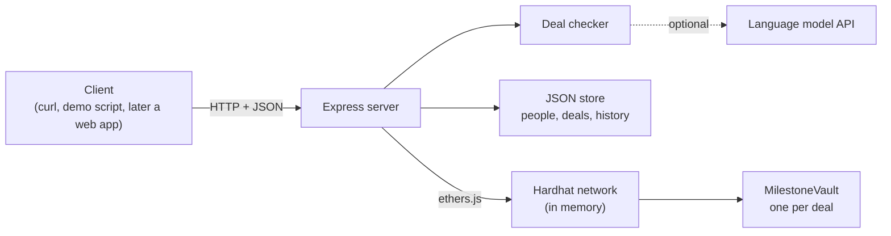
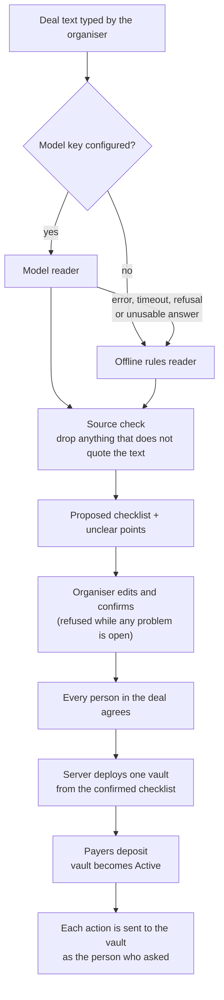
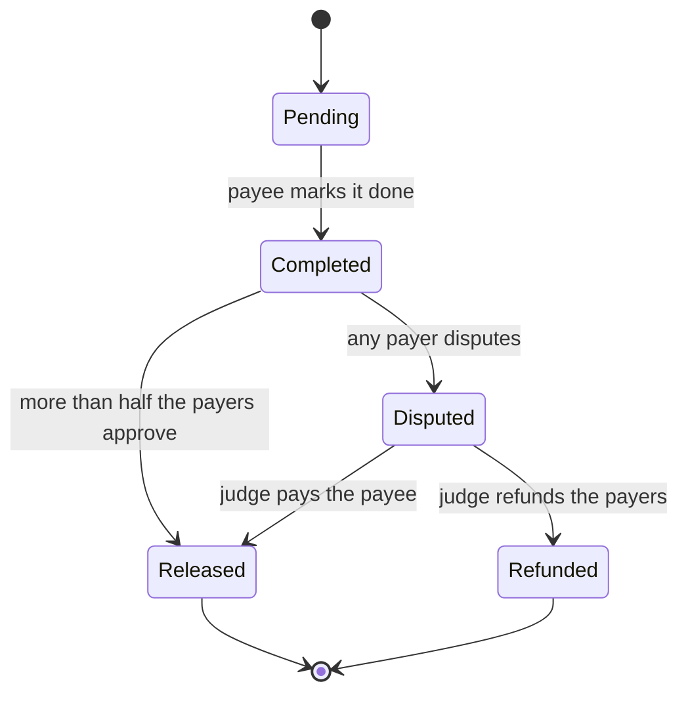

# Settl

**Turn a deal written in plain words into a locked agreement.** People join, money is locked in a smart contract, and each person is paid only when their stage is approved.

Built for VORTEXA 3.0, problem **B-03 MilestoneVault: Adversarial Smart-Contract Escrow**.

> All funds in this project are simulated. Nothing here moves real money or connects to a real payment system.

## Contents

- [The problem](#the-problem)
- [What Settl does](#what-settl-does)
- [Who can use it](#who-can-use-it)
- [Architecture](#architecture)
- [The vault contract](#the-vault-contract)
- [The deal checker (the AI part)](#the-deal-checker-the-ai-part)
- [The server](#the-server)
- [Project layout](#project-layout)
- [Tech stack](#tech-stack)
- [How to run it](#how-to-run-it)
- [Build status](#build-status)
- [Limits](#limits)
- [Roadmap](#roadmap)

## The problem

When work is paid in stages, both sides are afraid to go first. The payer fears losing the money, and the worker fears not being paid. Three things make it worse:

1. **The middleman is a black box.** Whoever holds the money sets hidden rules and can delay or favour one side.
2. **Agreements are vague.** A line like "pay when the work is good" becomes a dispute later.
3. **A program that holds money cannot make mistakes.** A payment released twice, the wrong person triggering a refund, or a re-entrant call can lose the money for good.

## What Settl does

1. **Describe.** One person, the organiser, types the deal in normal language.
2. **Check.** The deal checker turns the text into a checklist of who pays, who gets paid, who judges, the stages and the amounts. It marks every unclear line, and the organiser fixes them.
3. **Join.** The organiser adds the people. Each person reads the checklist and agrees, and the payers deposit their share. The deal is now locked.
4. **Do and approve.** The person responsible marks a stage done. The payers approve and that person is paid, or a payer disputes and the judge chooses "pay" or "refund".
5. **Finish.** Every stage is settled, the money adds up exactly, and the full history is visible.

Three roles cover every deal:

| Role | What they do |
|---|---|
| **Payers** | Put money in. There can be one or several, each with a share. |
| **Payees** | Get paid, one per stage. One person can be the payee of several stages. |
| **Judge** | Settles disputes. Never a payer or a payee, and can never take the money. |

These map directly onto the brief: the payers are the **client**, the payees are the **provider**, and the judge is the **arbiter**. A deal with one payer and one payee is exactly the case the brief describes.

## Who can use it

The contract only knows payers, payees, a judge and a list of stages, so the same code runs very different deals.

| Deal | Payers | Payees | Stages |
|---|---|---|---|
| Flatmates sharing wifi for a year | Three flatmates | The wifi provider | 12 monthly stages |
| Freelance work | The client | The freelancer | Design, development, launch |
| House construction | The owner | Mason, plumber, electrician | One per trade |
| Company bonus or project payout | The company | Employees | Project stages, one per person |

A sample of each is in [server/fixtures/](server/fixtures/).

## Architecture

### Components



| Component | Job | Where |
|---|---|---|
| Vault contract | Holds the money and enforces every rule about who may do what, and when | [contracts/MilestoneVault.sol](contracts/MilestoneVault.sol) |
| Deal checker | Reads deal text into a proposed checklist, with a model path and an offline path | [server/src/checker/](server/src/checker/) |
| Server | Stores deals and people, runs the agree step, deploys a vault from a confirmed checklist, forwards actions to the vault | [server/src/](server/src/) |
| Chain | A Hardhat network running inside the server process, with built-in test accounts | [hardhat.config.js](hardhat.config.js) |

### From text to a locked vault



Two design decisions matter most here:

- **The contract is not generated.** One vault contract was written and tested once. Every deal gets a fresh copy of it, filled in with that deal's people and amounts.
- **AI output never reaches the contract directly.** The model only proposes. A person must confirm, every member must agree, and only that confirmed checklist is used to create the vault. A fingerprint of the deal text and the confirmed checklist is stored in the vault, so the vault is tied to exactly what everyone agreed to.

## The vault contract

### Stage path



The vault itself moves through four phases: **Funding** (waiting for every payer's deposit), **Active**, **Cancelled** and **Closed** (every stage settled).

### Actions

| Action | Who | Allowed when | Effect |
|---|---|---|---|
| `deposit()` | A payer | Funding; this payer has not paid; the value equals their share | Records the deposit. When every payer has paid, the vault becomes Active |
| `cancel()` | A payer | Funding | The vault becomes Cancelled and each deposit is credited back to its payer |
| `markComplete(i)` | The payee of stage `i` | Active; stage is Pending | Stage becomes Completed |
| `approve(i)` | A payer, once per stage | Active; stage is Completed | Counts the approval. When more than half the payers have approved, the stage is Released and its amount is credited to the payee |
| `dispute(i)` | A payer | Active; stage is Completed | Stage becomes Disputed |
| `resolve(i, payPayee)` | The judge | Active; stage is Disputed | Released (credit the payee) or Refunded (credit the payers by share) |
| `withdraw()` | Anyone with credit | Credit above zero | Clears the credit, then sends the money |

Anything else is refused with a named error.

### How it stays safe

| Guarantee | How the contract does it | Proved by |
|---|---|---|
| No second release | A stage can be settled once. Its state changes before any credit is given | [test/attacks.test.js](test/attacks.test.js) |
| No unauthorised refund | `resolve` checks that the caller is the judge. The judge's only choices are pay or refund, and neither sends money to the judge | [test/attacks.test.js](test/attacks.test.js) |
| No out-of-order step | Every action checks the caller, then the vault phase, then the stage state | [test/attacks.test.js](test/attacks.test.js) |
| No re-entrancy theft | Money leaves through one function only. It clears the credit before sending, and it cannot be re-entered | [test/reentrancy.test.js](test/reentrancy.test.js) |
| Balance always reconciles | `reconciles()` checks that the balance equals deposits minus withdrawals, and also locked money plus owed money | Every test, plus [test/reconcile.test.js](test/reconcile.test.js) |
| Fair group rules | Approval needs more than half the payers; a refund is split by share, with the rounding remainder to the last payer | [test/group.test.js](test/group.test.js) |

### The re-entrancy demonstration

[contracts/demo/WeakVault.sol](contracts/demo/WeakVault.sol) is the real vault with the two `withdraw` protections removed. It is unsafe on purpose and exists only for comparison. The same attacker, [contracts/demo/ReentrantAttacker.sol](contracts/demo/ReentrantAttacker.sol), is run against both:

| | Real vault | WeakVault |
|---|---|---|
| Owed to the attacker | One stage | One stage |
| Attacker receives | Exactly one stage | Every stage in the vault |
| Honest payee afterwards | Still paid | Cannot be paid |

### Balance check under random actions

[test/reconcile.test.js](test/reconcile.test.js) sends hundreds of random actions at a vault, from the right people and the wrong ones, and checks the books after every single step. The sequence is seeded, so any failure can be replayed.

## The deal checker (the AI part)

The checker turns deal text into this checklist. Amounts are whole rupees.

```json
{
  "title": "Wifi for Flat 12, one year",
  "payers": [{ "name": "Asha", "share": 4800 }],
  "judge": { "name": "Mrs. Kulkarni" },
  "stages": [
    {
      "title": "Month 1",
      "payee": "QuickNet Broadband",
      "amount": 1200,
      "condition": "the three flatmates confirm the wifi worked that month",
      "source": "exact text copied from the deal"
    }
  ],
  "unclear": [{ "issue": "No launch date", "question": "What is the launch date?", "source": "" }],
  "total": 14400,
  "readBy": "model"
}
```

### Two readers, one set of checks

| Reader | When it runs | What it is |
|---|---|---|
| **Model reader** ([model.js](server/src/checker/model.js)) | A model key is configured | A language model fills in the checklist. Claude is used through the official SDK with a fixed JSON schema; Gemini is supported as an alternative |
| **Offline reader** ([rules.js](server/src/checker/rules.js)) | No key, or the model fails in any way | Fixed sentence patterns, no network. It is cautious by design: anything it cannot read becomes an unclear point |

Every result records which reader produced it (`readBy`) and, if the offline reader took over, why.

### What both readers must obey

- **Every stage must quote the deal text exactly.** A stage that does not is dropped and reported, never silently kept ([validate.js](server/src/checker/validate.js)).
- **Nothing is invented.** A missing name, amount or judge stays empty and becomes an unclear point with a question.
- **Vague wording is flagged.** Phrases such as "satisfactory", "a reasonable time" or "about ₹20,000" each become an unclear point that quotes the phrase.
- **Shared and repeating payments are expanded.** "Each of four people is paid ₹25,000" becomes four stages, and "₹1,200 every month for 12 months" becomes twelve.

### What stops a checklist being confirmed

A checklist cannot be confirmed while any of these is true:

- the payers' shares, the stage amounts and the total do not all agree;
- a stage has no payee or no amount;
- a quoted source is not in the deal text;
- someone named has not been added as a person;
- the judge is a payer or a payee, or a payee is also a payer;
- any unclear point is still open.

These checks are plain code. The model has no say in them.

## The server

`npm start` runs the Express server with the Hardhat network inside the same process, so one command starts everything. Each fictional person is mapped to one of the chain's built-in accounts, and every request names the acting `person`.

After a deal is locked, the server does not decide whether an action is allowed. It sends the transaction as that person and reports what the contract said. A refusal comes back as HTTP 409 with a plain-language reason.

The table shows the full API. See [Build status](#build-status) for which routes are live.

| Route | Purpose |
|---|---|
| `GET /health` | Server and chain are up |
| `GET /people`, `POST /people` | List or add fictional people. A neutral "Platform Mediator" exists by default and can be used as the judge |
| `POST /deals/draft` | Deal text in, proposed checklist and problem list out |
| `PUT /deals/:id/checklist` | The organiser edits the checklist. Any edit clears earlier agreements |
| `POST /deals/:id/confirm` | The organiser confirms. Refused while any problem is open |
| `POST /deals/:id/agree` | One member agrees |
| `POST /deals/:id/lock` | Refused until everyone has agreed. Deploys the vault |
| `POST /deals/:id/deposit`, `/cancel`, `/withdraw` | Money actions |
| `POST /deals/:id/stages/:n/complete`, `/approve`, `/dispute`, `/resolve` | Stage actions. `:n` counts from 1. `resolve` takes `"decision": "pay"` or `"refund"` |
| `GET /deals`, `GET /deals/:id` | Deal list, and one deal with its stage states and balances |
| `GET /deals/:id/history` | Accepted actions and refused attempts |
| `GET /deals/:id/summary` | Final settlement |
| `GET /attacks`, `POST /attacks/:name` | Run `second-release`, `unauthorised-refund`, `out-of-order` or `re-entrancy` on fresh vaults |

## Project layout

```
contracts/
  MilestoneVault.sol          the vault
  demo/WeakVault.sol          unsafe copy, for the re-entrancy comparison only
  demo/ReentrantAttacker.sol  the attacker used by tests and the attack demo
test/                         contract tests
  setup.test.js               what the vault refuses at creation
  lifecycle.test.js           payment, dispute-release and dispute-refund paths
  attacks.test.js             second release, unauthorised refund, out-of-order steps
  reentrancy.test.js          the same attacker against both vaults
  group.test.js               several payers: funding, majority approval, refund split
  reconcile.test.js           random actions with the balance checked after each
server/
  src/app.js, index.js        the API and its entry point
  src/store.js                JSON file store
  src/people.js               fictional people mapped to chain accounts
  src/chain.js                deploy, act, read state, plain-language refusal reasons
  src/deals.js                deal routes
  src/checker/                model.js, rules.js, validate.js, index.js
  fixtures/                   four sample deals
  test/                       server tests
samples/                      more sample deals with their expected checklists
hardhat.config.js, package.json, .env.example
```

## Tech stack

| Part | Tools |
|---|---|
| Contract | Solidity 0.8.28, OpenZeppelin `ReentrancyGuard` |
| Local chain and contract tests | Hardhat, ethers.js, Mocha and Chai |
| Server | Node.js, Express |
| Deal checker | Anthropic SDK for the model path, plain JavaScript for the offline path |
| Server tests | Node's built-in test runner |
| Storage | One JSON file, rewritten on each start |

Everything except the contract is JavaScript.

## How to run it

You need Node.js 22 or newer. The first compile downloads the Solidity compiler, so be online for that step.

```
npm install
npm test
npm start
```

| Command | What it does |
|---|---|
| `npm test` | Compiles the contracts and runs every contract test and server test |
| `npm run test:contract` | Contract tests only |
| `npm run test:server` | Server tests only |
| `npm start` | Starts the server at `http://localhost:3000` |

### Configuration

Copy `.env.example` to `.env`. Every value is optional.

| Variable | Meaning |
|---|---|
| `ANTHROPIC_API_KEY` | If set, the deal checker reads deals with Claude |
| `GEMINI_API_KEY` | Used when no Anthropic key is set. Needs `LLM_MODEL` |
| `LLM_MODEL` | Model name for the chosen provider. Defaults to `claude-opus-5-5` for Claude |
| `CHECKER_MODE` | Set to `rules` to force the offline reader even when a key is present |
| `PORT` | Server port. Defaults to 3000 |

With no key, the offline reader is used and everything else works the same.

## Build status

This section is updated as parts are finished.

| Part | Status |
|---|---|
| Vault contract | Done. 62 contract tests pass |
| Attack tests and the WeakVault comparison | Done |
| Deal checker: offline reader, validation, fallback | Done. 29 tests pass |
| Deal checker: model reader | Written. Not yet run against a live key |
| Server: health, people, draft | Done |
| Server: confirm, agree, lock, stage actions, history, summary, attack routes | In progress |
| End-to-end demo script (`npm run demo`) | Not built yet |
| Web app | Not built yet |

## Limits

- **All money is simulated.** There is no real UPI or bank connection.
- **"Locked in" covers only money already deposited.** A contract cannot take money from someone later, so payers deposit their full share at the start.
- **It cannot force anyone to do the work.** It controls only when money moves.
- **People still decide.** A person approves the work and a person judges a dispute. Settl does not decide whether work is good.
- **It does not replace a legal contract.**
- **There is no login.** The server acts as whichever person a request names, and it holds every test account. The contract still enforces each account's role, but a real deployment needs each person to sign with their own wallet.
- **The chain lives in memory.** Restarting the server clears every deal and vault.
- **The offline reader understands a limited set of sentence shapes.** Text outside them is reported as unclear, not guessed at.
- **`reconciles()` uses strict equality.** Ether forced into the vault from outside its functions would make it report false. No money can be taken out that way.

## Roadmap

| Level | Who uses it | What gets added |
|---|---|---|
| 1. Small group | A few payers, payees and one judge | This project |
| 2. Small business | One firm running many deals | This project: a new vault per deal |
| 3. Company | Teams in place of single people | Approval by several managers; a panel of judges deciding by majority |
| 4. Large enterprise | A main contractor with many subcontractors | Vaults that pay into other vaults, an inspector's sign-off as a condition, links to company accounts |

Also planned: an optional stake that a payee loses by walking away from a locked deal, monthly payments backed by a penalty deposit, and real rupee payments through a licensed payment partner.
