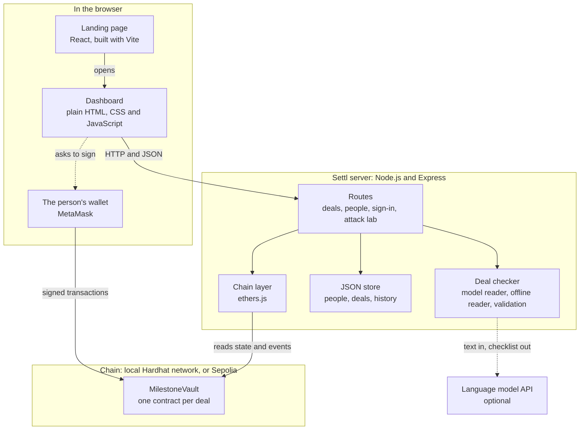
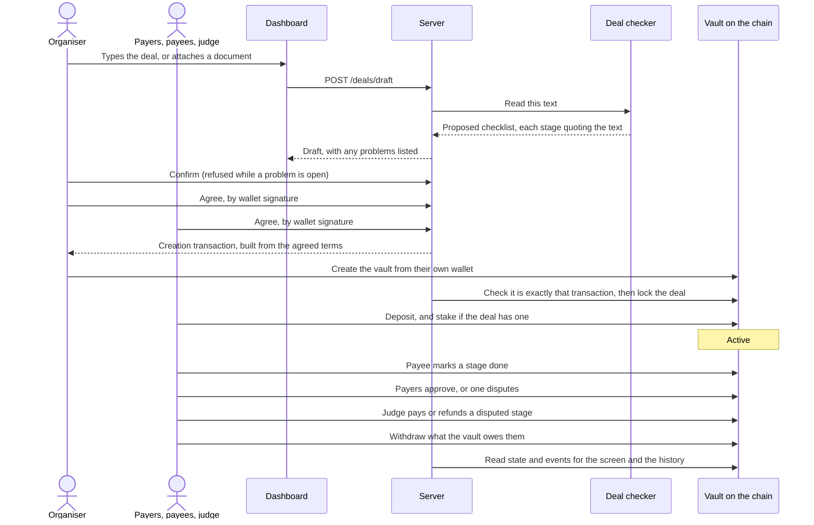
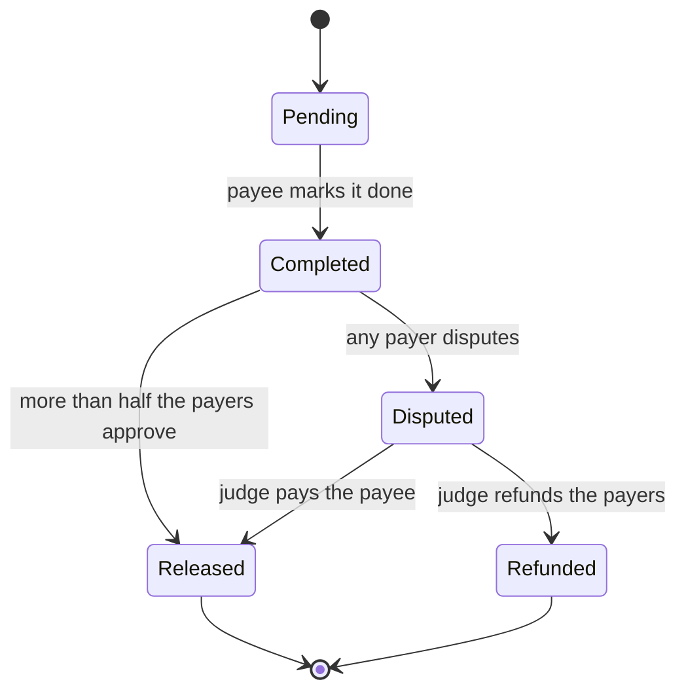

# Settl

**Turn a deal written in plain words into a locked agreement.** People join, money is locked in a smart contract, and each person is paid only when their stage is approved.

Built for VORTEXA 3.0, problem **B-03 MilestoneVault: Adversarial Smart-Contract Escrow**.

> All money in this project is test money. Nothing here moves real money or connects to a real payment system, and the server refuses to start on a network where money is real.

## Live

| | |
|---|---|
| Smart contract on Sepolia | [`0x01712404aDd94cd235d3F3Ed2cA8cB180334E62F`](https://sepolia.etherscan.io/address/0x01712404aDd94cd235d3F3Ed2cA8cB180334E62F) |
| Its source, verified as an exact match | [Read it on Sourcify](https://repo.sourcify.dev/11155111/0x01712404aDd94cd235d3F3Ed2cA8cB180334E62F) |
| A second vault, with a stake and a dispute | [`0x3890cC72EA90e3775a56Fcc8e7B07A32E2DA30c9`](https://sepolia.etherscan.io/address/0x3890cC72EA90e3775a56Fcc8e7B07A32E2DA30c9) |
| Contract source in this repository | [contracts/MilestoneVault.sol](contracts/MilestoneVault.sol) |
| Network | Sepolia test network, chain ID 11155111 |

Every deal gets its own copy of the same contract, so these are two of them. What each one did is described under [Live on Sepolia](#live-on-sepolia).

## At a glance

| | |
|---|---|
| **Input** | A deal typed in plain words, or attached as a text file, a PDF or a picture |
| **Output** | A vault contract holding the money, which pays each person only when their stage is approved |
| **Who signs** | Each person, with their own wallet. On a public network the server holds no key at all |
| **What the AI may do** | Propose a checklist. Every stage must quote the text, a person must confirm, and everyone must sign |
| **What stops cheating** | The contract. A stage cannot be paid twice, steps cannot be skipped, only the judge can settle a dispute, and a re-entrant withdrawal fails |
| **Evidence** | 81 contract tests, 103 server tests, four attacks run live, and two deals settled on Sepolia |

## Contents

- [The problem](#the-problem)
- [What Settl does](#what-settl-does)
- [Who can use it](#who-can-use-it)
- [Architecture](#architecture)
- [The vault contract](#the-vault-contract)
- [Security model](#security-model)
- [The deal checker (the AI part)](#the-deal-checker-the-ai-part)
- [The server](#the-server)
- [Wallets and real users](#wallets-and-real-users)
- [Project layout](#project-layout)
- [Tech stack](#tech-stack)
- [How to run it](#how-to-run-it)
- [Deployment](#deployment)
- [Build status](#build-status)
- [Limits](#limits)
- [Roadmap](#roadmap)

## The problem

When work is paid in stages, both sides are afraid to go first. The payer fears losing the money, and the worker fears not being paid. Three things make it worse:

1. **The middleman is a black box.** Whoever holds the money sets hidden rules and can delay or favour one side.
2. **Agreements are vague.** A line like "pay when the work is good" becomes a dispute later.
3. **A program that holds money cannot make mistakes.** A payment released twice, the wrong person triggering a refund, or a re-entrant call can lose the money for good.

## What Settl does

1. **Describe.** One person, the organiser, types the deal in normal language.
2. **Check.** The deal checker turns the text into a checklist of who pays, who gets paid, who judges, the stages and the amounts. It marks every unclear line, and the organiser fixes them.
3. **Join.** The organiser adds the people, by name or by wallet address. Each person reads the checklist and signs it. The vault is then created and the payers deposit their share. The deal is now locked.
4. **Do and approve.** The person responsible marks a stage done. The payers approve and that person is paid, or a payer disputes and the judge chooses "pay" or "refund".
5. **Finish.** Every stage is settled, the money adds up exactly, and the full history is visible.

Three roles cover every deal:

| Role | What they do |
|---|---|
| **Payers** | Put money in. There can be one or several, each with a share. |
| **Payees** | Get paid, one per stage. One person can be the payee of several stages. |
| **Judge** | Settles disputes. Never a payer or a payee, and can never take the money. |

These map directly onto the brief: the payers are the **client**, the payees are the **provider**, and the judge is the **arbiter**. A deal with one payer and one payee is exactly the case the brief describes.

## Who can use it

The contract only knows payers, payees, a judge and a list of stages, so the same code runs very different deals.

| Deal | Payers | Payees | Stages |
|---|---|---|---|
| Flatmates sharing wifi for a year | Three flatmates | The wifi provider | 12 monthly stages |
| Freelance work | The client | The freelancer | Design, development, launch |
| House construction | The owner | Mason, plumber, electrician | One per trade |
| Company bonus or project payout | The company | Employees | Project stages, one per person |
| Home repair with a stake | The owner | A tradesperson who stakes ₹5,000 | Two stages; the stake is lost by walking away |

A sample of each is in [server/fixtures/](server/fixtures/).

## Architecture

### Components



Three boundaries in this picture carry the design:

- **The model touches only text.** It sits behind the deal checker and returns a proposal. It has no route to the chain.
- **The wallet, not the server, sends a person's transactions.** The server prepares a transaction and checks the result. On a public network it holds no key.
- **The vault is the only thing that holds money or decides who may move it.** The server reads it; it cannot overrule it.

| Component | Job | Where |
|---|---|---|
| Landing page | Explains the product and opens the dashboard | [landing/](landing/) |
| Vault contract | Holds the money and enforces every rule about who may do what, and when | [contracts/MilestoneVault.sol](contracts/MilestoneVault.sol) |
| Deal checker | Reads deal text into a proposed checklist, with a model path and an offline path | [server/src/checker/](server/src/checker/) |
| Server | Stores deals and people, runs the agree step, creates a vault from a confirmed checklist or prepares that transaction for the organiser's wallet, and forwards actions to the vault | [server/src/](server/src/) |
| Dashboard | One page: a bar to describe a deal, a workspace of deals, and the open deal with the steps the signed-in person can take | [app/](app/) |
| Chain | By default a Hardhat network running inside the server process, with built-in test accounts. Optionally a public test network such as Sepolia | [hardhat.config.js](hardhat.config.js) |

### From text to a locked vault


### One deal, from start to finish



Before a wallet is opened for any step, the server asks the chain whether the contract would accept it. A refusal is shown in plain words and recorded, and no transaction is sent.

Three design decisions matter most here:

- **The contract is not generated.** One vault contract was written and tested once. Every deal gets a fresh copy of it, filled in with that deal's people and amounts.
- **Whoever creates the vault cannot change it.** For demo people the server creates it. For wallet people the organiser's own wallet does, from a transaction the server builds out of the agreed terms. The server accepts the result only if the transaction on the chain matches that one byte for byte.
- **AI output never reaches the contract directly.** The model only proposes. A person must confirm, every member must agree, and only that confirmed checklist is used to create the vault. A fingerprint of the deal text and the confirmed checklist is stored in the vault, so the vault is tied to exactly what everyone agreed to.

## The vault contract

### Stage path



The vault itself moves through four phases: **Funding** (waiting for every payer's deposit), **Active**, **Cancelled** and **Closed** (every stage settled).

### Actions

| Action | Who | Allowed when | Effect |
|---|---|---|---|
| `deposit()` | A payer | Funding; this payer has not paid; the value equals their share | Records the deposit. The vault becomes Active when every payer has paid and, if a stake is set, every payee has staked |
| `stake()` | A payee | Funding; a stake is set; this payee has not staked; the value equals the stake | Records the stake. It is credited back when the deal closes |
| `cancel()` | A payer | Funding | The vault becomes Cancelled and each deposit and stake is credited back to whoever made it |
| `markComplete(i)` | The payee of stage `i` | Active; stage is Pending | Stage becomes Completed |
| `approve(i)` | A payer, once per stage | Active; stage is Completed | Counts the approval. When more than half the payers have approved, the stage is Released and its amount is credited to the payee |
| `dispute(i)` | A payer | Active; stage is Completed | Stage becomes Disputed |
| `resolve(i, payPayee)` | The judge | Active; stage is Disputed | Released (credit the payee) or Refunded (credit the payers by share) |
| `leave()` | A payee with an unsettled stage | Active; a stake is set; this payee has not left | Their unsettled stages are refunded to the payers, and their stake is credited to the payers by share |
| `withdraw()` | Anyone with credit | Credit above zero | Clears the credit, then sends the money |

Anything else is refused with a named error.

The stake is optional and set per deal; zero switches it off. It gives a payee a reason not to walk away from a locked deal. A forfeited stake goes to the payers, never to the judge, so nobody gains by pushing a payee out.

### How it stays safe

| Guarantee | How the contract does it | Proved by |
|---|---|---|
| No second release | A stage can be settled once. Its state changes before any credit is given | [test/attacks.test.js](test/attacks.test.js) |
| No unauthorised refund | `resolve` checks that the caller is the judge. The judge's only choices are pay or refund, and neither sends money to the judge | [test/attacks.test.js](test/attacks.test.js) |
| No out-of-order step | Every action checks the caller, then the vault phase, then the stage state | [test/attacks.test.js](test/attacks.test.js) |
| No re-entrancy theft | Money leaves through one function only. It clears the credit before sending, and it cannot be re-entered | [test/reentrancy.test.js](test/reentrancy.test.js) |
| Balance always reconciles | `reconciles()` checks that the balance equals deposits minus withdrawals, and also locked money plus owed money | Every test, plus [test/reconcile.test.js](test/reconcile.test.js) |
| Fair group rules | Approval needs more than half the payers; a refund is split by share, with the rounding remainder to the last payer | [test/group.test.js](test/group.test.js) |
| The stake cannot be gamed | It is returned only at the close, a payee who left never gets it back, and `leave` cannot be used twice, by an outsider, or to pull the stake out early | [test/stake.test.js](test/stake.test.js) |

### The re-entrancy demonstration

[contracts/demo/WeakVault.sol](contracts/demo/WeakVault.sol) is the real vault with the two `withdraw` protections removed. It is unsafe on purpose and exists only for comparison. The same attacker, [contracts/demo/ReentrantAttacker.sol](contracts/demo/ReentrantAttacker.sol), is run against both:

| | Real vault | WeakVault |
|---|---|---|
| Owed to the attacker | One stage | One stage |
| Attacker receives | Exactly one stage | Every stage in the vault |
| Honest payee afterwards | Still paid | Cannot be paid |

### Balance check under random actions

[test/reconcile.test.js](test/reconcile.test.js) sends hundreds of random actions at a vault, from the right people and the wrong ones, and checks the books after every single step. The sequence is seeded, so any failure can be replayed.

## Security model

What could go wrong, what prevents it, and where that is proven.

| Threat | What prevents it | Proven by |
|---|---|---|
| A stage is paid twice | A stage moves one way through its states and can be released once. Money is credited, then withdrawn by the person owed it | [test/attacks.test.js](test/attacks.test.js); attack lab "Second release" |
| Someone other than the judge settles a dispute | The contract checks the caller. The payer, the payee and strangers are refused | [test/attacks.test.js](test/attacks.test.js); attack lab "Unauthorised refund"; refused live on Sepolia |
| Steps are skipped or repeated | Every action checks the deal's phase and the stage's state first | [test/attacks.test.js](test/attacks.test.js); attack lab "Out of order" |
| A contract withdraws again before the first payment is recorded | The credit is set to zero before any money is sent, and `withdraw` is guarded against re-entry | [test/reentrancy.test.js](test/reentrancy.test.js); the same attacker drains the deliberately weak copy |
| The judge takes the money, or is one of the parties | The judge can only choose "pay the payee" or "refund the payers". A vault whose judge is also a payer or payee cannot be created | [test/setup.test.js](test/setup.test.js) |
| The money stops adding up | `reconciles()` compares the vault's balance with what it still owes and holds | Checked after every step in [test/reconcile.test.js](test/reconcile.test.js), under random actions |
| The AI invents or misreads a term | A stage that does not quote the deal text is dropped. A person must confirm, and every member must sign | [server/test/checker.test.js](server/test/checker.test.js) |
| The terms, the accounts or the document change after signing | The fingerprint each person signs covers the text, the checklist, every member's address and any attached file. Any edit clears the signatures. The vault stores the fingerprint | [server/test/api.test.js](server/test/api.test.js), [server/test/wallet.test.js](server/test/wallet.test.js) |
| A vault is created with different terms | The creation transaction must match, byte for byte, the one built from the agreed terms, and must come from the organiser | [server/test/wallet.test.js](server/test/wallet.test.js) |
| Someone acts as another person | A wallet person is known only by a session opened with their signature. Naming them in a request is refused | [server/test/wallet.test.js](server/test/wallet.test.js) |
| The server's record disagrees with the chain | Who did what is read from the vault's own events, and the screen reads the vault's state | [server/test/wallet.test.js](server/test/wallet.test.js); found and fixed during the first Sepolia run |
| Real money is used by mistake | The server starts only on a known test network | [server/src/chain.js](server/src/chain.js) |

What is not covered is listed under [Limits](#limits).

## The deal checker (the AI part)

The checker turns deal text into this checklist. Amounts are whole rupees.

```json
{
  "title": "Wifi for Flat 12, one year",
  "payers": [{ "name": "Asha", "share": 4800 }],
  "judge": { "name": "Mrs. Kulkarni" },
  "stages": [
    {
      "title": "Month 1",
      "payee": "QuickNet Broadband",
      "amount": 1200,
      "condition": "the three flatmates confirm the wifi worked that month",
      "source": "exact text copied from the deal"
    }
  ],
  "unclear": [{ "issue": "No launch date", "question": "What is the launch date?", "source": "" }],
  "total": 14400,
  "stake": 0,
  "readBy": "model"
}
```

### Two readers, one set of checks

| Reader | When it runs | What it is |
|---|---|---|
| **Model reader** ([model.js](server/src/checker/model.js)) | A model key is configured | A language model fills in the checklist. Claude is used through the official SDK with a fixed JSON schema; Gemini is supported as an alternative |
| **Offline reader** ([rules.js](server/src/checker/rules.js)) | No key, or the model fails in any way | Fixed sentence patterns, no network. It is cautious by design: anything it cannot read becomes an unclear point |

Every result records which reader produced it (`readBy`) and, if the offline reader took over, why.

### What both readers must obey

- **Every stage must quote the deal text.** The quote is matched against the text and replaced by the text's own wording, so what is stored is always an exact piece of the deal. A stray word or comma at the edge of a quote is tolerated; a stage whose quote cannot be found is dropped and reported, never silently kept ([validate.js](server/src/checker/validate.js)).
- **Nothing is invented.** A missing name, amount or judge stays empty and becomes an unclear point with a question.
- **Vague wording is flagged.** Phrases such as "satisfactory", "a reasonable time" or "about ₹20,000" each become an unclear point that quotes the phrase.
- **Shared and repeating payments are expanded.** "Each of four people is paid ₹25,000" becomes four stages, and "₹1,200 every month for 12 months" becomes twelve.

### What stops a checklist being confirmed

A checklist cannot be confirmed while any of these is true:

- the payers' shares, the stage amounts and the total do not all agree;
- a stage has no payee or no amount;
- a quoted source is not in the deal text;
- someone named has not been added as a person;
- the judge is a payer or a payee, or a payee is also a payer;
- any unclear point is still open.

These checks are plain code. The model has no say in them.

### How well the readers do, measured

`npm run score` reads the eight sample deals in [samples/deals/](samples/deals/), which are written in free everyday language, and compares each result with the expected checklist written beside it. Five things are checked per deal: the payers and their shares, the judge, the number of stages, the stage total, and whether a clean deal was left clean and a flawed one flagged.

| Reader | Checks right | Time per deal |
|---|---|---|
| Model reader (Gemini `gemini-3.5-flash-lite`) | 36 of 40 | about 2 seconds |
| Offline reader | 8 of 40 | instant |

This is one run on eight deals, so treat it as an indication, and expect the model's figure to move a little between runs. It shows what each reader is for. The model reads ordinary writing. The offline reader only understands a fixed set of sentence shapes, such as those in [server/fixtures/](server/fixtures/), which it reads fully; on anything else it reports that it could not read the line instead of guessing. It keeps the product working without a model, with less reading ability.

## The server

`npm start` runs the Express server with the Hardhat network inside the same process, so one command starts everything. Each fictional person is mapped to one of the chain's built-in accounts, and every request names the acting `person`. A person who signs in with a wallet is known by their session instead, and signs their own transactions.

After a deal is locked, the server does not decide whether an action is allowed. It sends the transaction as that person and reports what the contract said. A refusal comes back as HTTP 409 with a plain-language reason.

Stage numbers in the API count from 1.

| Route | Purpose |
|---|---|
| `GET /health` | Server and chain are up |
| `GET /people`, `POST /people` | List or add people. `{ name }` adds a demo person. `{ name, address }` adds a person by wallet address; they act once they sign in with that wallet. On the local chain a neutral "Platform Mediator" exists by default and can be used as the judge |
| `POST /deals/draft` | Deal text in, proposed checklist and problem list out. Takes an optional `document`: `{ name, text }` for a text file, or `{ name, type, data }` with base64 content for a PDF or a picture |
| `PUT /deals/:id/checklist` | The organiser edits the checklist. Any edit clears earlier agreements |
| `PUT /deals/:id/text` | The organiser rewrites the deal's words and has them read again. Clears earlier agreements |
| `DELETE /deals/:id` | The organiser discards a deal that was never locked |
| `POST /deals/:id/confirm` | The organiser confirms. Refused while any problem is open |
| `POST /deals/:id/agree` | One member agrees |
| `POST /deals/:id/lock` | Refused until everyone has agreed. For a demo organiser the server creates the vault. For a wallet organiser it returns the creation transaction for their wallet to send |
| `POST /deals/:id/deposit`, `/cancel`, `/withdraw` | Money actions |
| `POST /deals/:id/stake`, `/leave` | A payee puts in the stake, or walks away from a locked deal |
| `POST /deals/:id/stages/:n/complete`, `/approve`, `/dispute`, `/resolve` | Stage actions. `:n` counts from 1. `resolve` takes `"decision": "pay"` or `"refund"` |
| `GET /deals`, `GET /deals/:id` | Deal list, and one deal with its stage states and balances |
| `GET /deals/:id/history` | Accepted actions and refused attempts |
| `GET /deals/:id/summary` | Final settlement |
| `GET /attacks`, `POST /attacks/:name` | Run `second-release`, `unauthorised-refund`, `out-of-order` or `re-entrancy` on fresh vaults. On a public network each attack runs on a local chain of its own |
| `GET /auth/message`, `POST /auth/sign-in`, `POST /auth/sign-out`, `GET /auth/me` | Wallet sign-in |
| `POST /rpc` | The local chain, for wallets. Not offered on a public network, which wallets reach themselves |
| `POST /deals/:id/transactions` | A wallet person reports a transaction their wallet sent: a step on the vault, or the creation of the vault itself |
| `GET /contract` | The vault's interface, the network's name and chain ID, and the test-money rate |
| `POST /reset` | Local chain only. Starts again from nothing: a fresh chain, no deals, only the built-in mediator. For demonstrations |

### The dashboard

`npm start` serves the dashboard in [app/](app/) at `http://localhost:3000/app/`. The landing page in [landing/](landing/) is the front door at `http://localhost:3000/` once it has been built with `npm run build`, and its buttons open the dashboard; until then `/` goes straight to the dashboard. The dashboard is one page with three parts.

| Part | What it does |
|---|---|
| **The bar** | Type a deal in plain words and press Enter, or use **Attach** to add the agreement as a file. Four one-click examples sit under it. The "AI" switch chooses between the model and the offline reader |
| **The workspaces** | The deals you organise or are part of, each with its amount, status and progress. Every workspace has its own link |
| **The open workspace** | Four steps (Check, Sign, Fund, Pay) and the one thing you can do next, then three tabs. **Workspace**: the escrow totals, each person with what they have in escrow, and the stages. **Agreement**: the whole deal in plain sentences, what happens if someone breaks it, the attempts refused so far, who has signed, and the original words. **Activity**: every step and every refusal |

How it behaves:

- **It shows only what you can do.** The button on a deal is your next step: Confirm, Sign, Create vault, Deposit, Done, Approve, Dispute, Pay, Refund or Withdraw. If it is someone else's turn, it says who the deal is waiting for.
- **Before the lock, every stage shows the words it was read from**, so the organiser checks the reader's work against the text. Problems and unclear points block Confirm until they are fixed, by editing the words and reading again or by accepting the point.
- **Missing people are added in place.** Paste a wallet address next to a name, or on the local chain leave it empty to add a demo person.
- **It works with a wallet or without one.** With a wallet, every signature and transaction comes from the wallet. Without one, on the local chain, you pick or add a demo person from the menu at the top right and the server acts for them.
- **Once a deal is over, a settlement table** shows what each person paid in, received and ended up with, and whether it adds up. The figures come from the vault's own events.
- **"Attacks" opens the attack lab**, which runs the four attacks and shows each step and its outcome.
- **"How Settl works" in the footer** opens the page in [site/](site/) that explains the project, served at `/site`.

**Attached documents.** A text file is used as it is, and works with the AI switched off. A PDF or a picture has its words copied out by the model, so it needs the model; with the AI off it is refused with that reason. Either way the result is only more text for the reader: every stage must still quote it, the organiser sees the copied-out words under Agreement, and a person must confirm. A fingerprint of the file itself goes into the agreement fingerprint stored in the vault. A sample is in [server/fixtures/06-photography-agreement.pdf](server/fixtures/06-photography-agreement.pdf). Limits: 4 MB and 20,000 characters.


## Wallets and real users

There are two kinds of people.

| Kind | Who they are | How the server knows it is them | Who signs their transactions |
|---|---|---|---|
| **Demo person** | A fictional name added with `POST /people`. Local chain only | It does not. The request just names them | The server, with a built-in chain account it holds for them |
| **Wallet person** | A real person with their own wallet | They sign a one-time message with the wallet, and the server checks the signature against the address | Their own wallet. The server holds no key for them |

Demo people exist so the product can be shown without any set-up. Wallet people are the real thing: nobody can act as one by typing their name, because the server refuses a request that names a wallet person without that person's session.

### What a wallet person does

1. **Signs in.** The wallet signs a short message that proves the address is theirs. It costs nothing and moves no money. A first sign-in also takes their name. On the local chain, a wallet that arrives empty is given test money.
2. **Is added by address, if they have not signed in yet.** An organiser can put a name against a wallet address so the deal can name that person. This gives nobody any power: to act, the person still has to sign in with the wallet that owns the address.
3. **Agrees by signature.** To agree to a deal, they sign a message that lists every member's wallet address and carries the deal's fingerprint. The fingerprint covers the text, the checklist and those addresses, so the vault can only be created for the accounts everyone signed for. The signature is stored with the deal, and anyone can check it against their address. Editing the checklist changes the fingerprint, so old signatures stop fitting and are thrown away.
4. **Creates the vault, if they are the organiser.** The server builds the creation transaction from the agreed terms and the organiser's wallet sends it. The deal is locked only when that exact transaction, sent by the organiser, is found on the chain. A creation sent by anyone else, or one with different terms, is refused.
5. **Sends their own transactions.** For a deposit or a stage action, the server first asks the chain whether the contract would accept it from that address. If not, it answers with the plain reason and the wallet is never opened. If so, it hands back the transaction, and the person's wallet signs and sends it.

A wallet can also call the vault directly without asking the server. The contract's rules apply either way, and the deal's state is always read from the chain.

### Two networks

| | Local (default) | Public test network |
|---|---|---|
| Start with | `npm start` | `npm run testnet` (Sepolia), or `CHAIN_RPC_URL` in `.env` |
| Where vaults live | A Hardhat network inside the server process | On the test network, visible in its block explorer |
| People | Demo people and wallet people | Wallet people only. The server holds no key at all |
| Test money | Given to a wallet when it signs in. ₹1,000 is 1 test ETH | Collected from a faucet. ₹1,000 is 0.000001 test ETH |
| How a wallet reaches the chain | Through the server at `POST /rpc`, or `http://localhost:8545` (chain ID `31337`) | Directly. The server's own RPC address is never sent to a browser |
| After a restart | Chain, deals and people start empty | Vaults remain on the network, and deals are kept in `server/data/testnet.json` |

On the local chain the server lets through only what a wallet needs: reading the chain and sending transactions the wallet has already signed. Requests that would make the node sign with the demo accounts' keys, or rewrite the chain, are refused.

The server starts only on a known test network: Sepolia, Holesky, Base Sepolia, Arbitrum Sepolia, OP Sepolia, Polygon Amoy or a local chain. Pointed at any other network, it stops with an error.

### Live on Sepolia

A deal has been run from start to finish on the Sepolia test network, with three MetaMask accounts and test money only.

| | |
|---|---|
| Vault | `0x01712404aDd94cd235d3F3Ed2cA8cB180334E62F` |
| On the explorer | https://sepolia.etherscan.io/address/0x01712404aDd94cd235d3F3Ed2cA8cB180334E62F |
| Source, verified as an exact match | https://repo.sourcify.dev/11155111/0x01712404aDd94cd235d3F3Ed2cA8cB180334E62F |
| What was done | The organiser's wallet created the vault, the payer deposited, the payee marked the stage done, the payer approved, and the payee withdrew. Nothing is left in the vault and the settlement adds up |

A second deal, with a stake and a dispute, was then run on Sepolia by script, with three test wallets signing through the same server routes the dashboard uses.

| | |
|---|---|
| Vault | `0x3890cC72EA90e3775a56Fcc8e7B07A32E2DA30c9` |
| On the explorer | https://sepolia.etherscan.io/address/0x3890cC72EA90e3775a56Fcc8e7B07A32E2DA30c9 |
| What was done | The payer deposited ₹20,000 and the payee staked ₹2,000. Stage 1 was approved and paid. Stage 2 was disputed and the judge refunded it. Both withdrew, the stake came back, nothing is left in the vault and the settlement adds up |
| Refused on the way | The payee approving their own stage, the judge ruling with no dispute, and the payer ruling on their own dispute |
| Cost | 0.000164 test ETH for all eleven transactions, at a tip of 0.01 gwei |

Two things these runs taught us:

- **A wallet does not always send a transaction straight to the vault.** MetaMask's optional "added protection" routes it through a contract of its own. The server now takes who did what from the vault's own events, so it records a step however it arrived, including steps taken on the contract without the server at all.
- **Creating a vault is expensive on Sepolia:** about 13.8 million gas, several times what the local chain charges. With MetaMask's default fee that was about 0.02 test ETH. The dashboard now asks for a smaller fee.

### Trying it with MetaMask

[SETUP.md](SETUP.md) has the full steps for someone who has never used a wallet, including where to get test ETH. In short:

1. Run `npm start` and open `http://localhost:3000`.
2. Click **Connect**. The page asks MetaMask to add and switch to the network. Use a fresh account with no real funds.
3. Enter a name and approve the sign-in message.
4. To play several people on one laptop, add more accounts in MetaMask and switch between them. The page follows the switch.

Restarting the server resets the local chain. If transactions then fail, use MetaMask → Settings → Advanced → "Clear activity tab data".

Set `REQUIRE_WALLET=true` to switch demo people off on the local chain too, so every action needs a wallet session.

**What has been tested:** the whole flow on the local chain, with real keys signing real transactions through `/rpc`, in [server/test/wallet.test.js](server/test/wallet.test.js); and one plain deal on Sepolia through the dashboard with MetaMask, described above. **What has not:** the stake, dispute, cancel and leave paths have not been run on Sepolia, and a vault created with MetaMask's "added protection" switched on would not be recognised.

## Project layout

```
contracts/
  MilestoneVault.sol          the vault
  demo/WeakVault.sol          unsafe copy, for the re-entrancy comparison only
  demo/ReentrantAttacker.sol  the attacker used by tests and the attack demo
test/                         contract tests
  setup.test.js               what the vault refuses at creation
  lifecycle.test.js           payment, dispute-release and dispute-refund paths
  attacks.test.js             second release, unauthorised refund, out-of-order steps
  reentrancy.test.js          the same attacker against both vaults
  group.test.js               several payers: funding, majority approval, refund split
  stake.test.js               the optional stake: funding, return, leaving, cheat attempts
  reconcile.test.js           random actions with the balance checked after each
server/
  src/app.js, index.js        the API and its entry point
  src/store.js                JSON file store
  src/people.js               demo people (server-held accounts) and wallet people
  src/auth.js                 wallet sign-in and sessions
  src/rpc.js                  the local chain, passed through for wallets
  src/chain.js                the network, deploy, act, read state, plain-language refusal reasons
  src/deals.js                deal routes
  src/attacks.js              the attack lab
  src/checker/                model.js, rules.js, validate.js, index.js
  fixtures/                   five sample deals, and one as a PDF
  test/                       checker tests, API tests and wallet tests
app/                          the dashboard, served at /app/
  index.html, settl.css, settl.js
landing/                      the landing page (React), built into dist/ and served at /
site/                         a page that explains the project, served at /site
wallet/index.html             the wallet console, served at /wallet
scripts/demo.js               end-to-end run of five deals and four attacks
scripts/score.js              scores the deal checker against the sample deals
samples/                      more sample deals with their expected checklists
SETUP.md                      wallet set-up for people new to MetaMask
render.yaml                   deployment to Render
hardhat.config.js, vite.config.mjs, package.json, .env.example
```

## Tech stack

| Part | Tools |
|---|---|
| Contract | Solidity 0.8.28, OpenZeppelin `ReentrancyGuard` |
| Local chain and contract tests | Hardhat, ethers.js, Mocha and Chai |
| Server | Node.js, Express |
| Dashboard | Plain HTML, CSS and JavaScript, with ethers.js for the wallet. No build step |
| Landing page | React, Vite, styled-components |
| Deal checker | Claude through the Anthropic SDK, or Gemini over REST, for the model path. Plain JavaScript for the offline path |
| Hosting | Render, from [render.yaml](render.yaml) |
| Server tests | Node's built-in test runner |
| Storage | One JSON file, rewritten on each start |

Everything except the contract is JavaScript.

## How to run it

You need Node.js 22 or newer. The first compile downloads the Solidity compiler, so be online for that step.

```
npm install
npm test
npm run demo
npm start
```

| Command | What it does |
|---|---|
| `npm test` | Compiles the contracts and runs every contract test and server test |
| `npm run test:contract` | Contract tests only |
| `npm run test:server` | Server tests only |
| `npm run demo` | Runs five deals from plain text to final payout through the API, then the four attacks, printing each step. Exits with an error if any step differs from what it states |
| `npm run score` | Scores the deal checker against the sample deals in `samples/deals/` |
| `npm start` | Starts the server on the local chain. The dashboard is at `http://localhost:3000/app/` |
| `npm run landing` | Builds the landing page, then starts the server. The landing page is at `http://localhost:3000/` and its buttons open the dashboard |
| `npm run dev` | The landing page alone, with live reload, for working on it |
| `npm run testnet` | The same, on the Sepolia test network. Needs a wallet with test ETH; see [SETUP.md](SETUP.md) |

### What the demo shows

`npm run demo` needs no key and no set-up, and gives the same result every time.

| Part | What happens |
|---|---|
| Freelance website | One payer, one payee, one judge: the case in the brief. Wrong moves are tried at each step and refused |
| Flatmates sharing wifi | Three payers. The deal starts only when all three have paid, and a stage is released on two approvals out of three |
| House construction | Three trades. One dispute is settled for the payee and one for the payer; nobody but the judge can settle either |
| Company bonus | One payer and four employees, with one stage per person |
| Kitchen retiling with a stake | The deal starts only once the payee has staked. The payee then walks away: the unfinished stage is refunded and the stake goes to the payer |
| Attack lab | Second release, unauthorised refund, out-of-order steps, and re-entrancy against both the real vault and the weak copy |
| Model reader | Only when a key is set: reads one deal with the model and reports what came back |

### Trying it by hand

With the server running (in PowerShell, type `curl.exe` in place of `curl`):

```
curl -X POST localhost:3000/people -H "content-type: application/json" -d "{\"names\":[\"Riya\",\"Aman\",\"Meera\"]}"
curl -X POST localhost:3000/deals/draft -H "content-type: application/json" -d "{\"person\":\"Riya\",\"text\":\"Riya pays Rs 30000 for a website. Aman is paid Rs 30000 when the site is live. Meera settles any dispute.\"}"
curl -X POST localhost:3000/deals/deal-1/confirm -H "content-type: application/json" -d "{\"person\":\"Riya\"}"
curl -X POST localhost:3000/attacks/re-entrancy
```

### Configuration

Copy `.env.example` to `.env` and put your values in `.env`. Every value is optional. Never put a real key in `.env.example`: that file is committed, while `.env` is ignored by git.

| Variable | Meaning |
|---|---|
| `ANTHROPIC_API_KEY` | If set, the deal checker reads deals with Claude |
| `GEMINI_API_KEY` | Used when no Anthropic key is set. Needs `LLM_MODEL` |
| `LLM_MODEL` | Model name for the chosen provider. Defaults to `claude-opus-5-5` for Claude |
| `CHECKER_MODE` | Set to `rules` to force the offline reader even when a key is present |
| `REQUIRE_WALLET` | Set to `true` to allow wallet people only. Demo people are switched off |
| `CHAIN_RPC_URL` | The address of a public test network. When set, Settl runs there in place of the local chain. Keep it in `.env`; it can contain a provider key |
| `RUPEE_WEI` | How much test coin one rupee is, in wei. Defaults to 10^15 on the local chain and 10^9 on a public one |
| `PORT` | Server port. Defaults to 3000 |
| `RPC_PORT` | Second port where wallets can reach the local chain. Defaults to 8545 |

With no key, the offline reader is used and everything else works the same.

## Deployment

Settl deploys to [Render](https://render.com) as one web service, described in [render.yaml](render.yaml). On Render choose New, then Blueprint, pick this repository, and paste the model key when asked.

| Setting | Value |
|---|---|
| Build | `npm install --include=dev && npx hardhat compile && npx vite build` |
| Start | `node server/src/index.js --testnet` |
| Network | Sepolia. Visitors connect MetaMask and sign with their own wallet |
| Secrets | `GEMINI_API_KEY`, set in Render's dashboard. No key is stored in this repository |
| Health check | `/health` |

| Address on the deployed site | What it serves |
|---|---|
| `/` | The landing page |
| `/app/` | The dashboard |
| `/site/` | The page that explains the project |

What to know about the free plan:

- **It sleeps when idle** and takes up to a minute to wake.
- **The list of workspaces is kept in a file that does not survive a restart.** The vaults stay on Sepolia; only the server's list is lost. A database is the fix and is not built yet.
- **Every push to `main` redeploys the service.**
- **To change the model key,** edit it under Environment in Render. The service restarts with the new key.

## Build status

| Part | Status |
|---|---|
| Vault contract, including the optional stake | Done. 81 contract tests pass. The contract has not changed since |
| Attack tests and the WeakVault comparison | Done |
| Deal checker: offline reader, validation, fallback | Done. 34 tests pass |
| Deal checker: model reader | Done. Run against Gemini (`gemini-3.5-flash-lite`): see the measured figures above. The Claude path has not been run against a live key |
| Server: every route in the table above | Done. 30 API tests pass |
| Wallet sign-in, people added by address, signed agreements, wallet-created vaults, wallet-sent transactions | Done. 37 tests pass, using real keys through `/rpc` on the local chain |
| End-to-end demo (`npm run demo`) | Done before the latest server changes. Not re-run since |
| Dashboard (`/`) | Done. Run through the real page in a headless browser: a plain deal with a dispute, a deal with a stake where the payee leaves, the agreement tab, the attack lab, and the whole wallet path with three keys. Also used by hand with MetaMask on Sepolia |
| Public test network (`npm run testnet`) | Two deals run end to end on Sepolia: a plain one by hand with MetaMask, and one with a stake and a dispute by script. The first vault's source is verified. The cancel and leave paths have not been run there |
| Attack lab on a public network | Written. Not yet run |
| Wallet console page (`/wallet`) | Written before the organiser's wallet began creating the vault. Its Lock button has not been updated for that; use the dashboard |

## Limits

- **All money is test money.** There is no real UPI or bank connection, and the server will not start on a real-money network.
- **"Locked in" covers only money already deposited.** A contract cannot take money from someone later, so payers deposit their full share at the start.
- **It cannot force anyone to do the work.** It controls only when money moves. The optional stake gives a payee a reason to finish, nothing more.
- **There are no deadlines.** If a payee never marks a stage done and never leaves, that stage's money stays locked. A time limit after which the payers can reclaim it is planned.
- **People still decide.** A person approves the work and a person judges a dispute. Settl does not decide whether work is good.
- **It does not replace a legal contract.**
- **Demo people have no login.** The server acts as whichever demo person a request names. Wallet people are authenticated by signature and sign their own transactions; `REQUIRE_WALLET=true` allows only them.
- **A name is tied to an address by whoever adds it first.** Each member's address is shown next to their name and listed in the message they sign, so check it before signing.
- **Creating a vault costs a lot of gas.** Each deal deploys the whole contract. On a network with real fees, a factory that makes light copies of one vault would be needed.
- **A vault must be created by a transaction sent straight from the organiser's wallet.** One routed through another contract, as MetaMask's "added protection" does, is not recognised.
- **A session is a token held in memory.** It ends when the server restarts, and it is not tied to a browser or device.
- **The local chain lives in memory.** Restarting the server clears every deal and vault. On a public test network the vaults stay and the deals are kept in a file.
- **On a public test network every step costs a little test coin for gas**, so each person needs some, the payees and the judge included.
- **The offline reader understands a limited set of sentence shapes.** Text outside them is reported as unclear, not guessed at.
- **`reconciles()` uses strict equality.** Ether forced into the vault from outside its functions would make it report false. No money can be taken out that way.

## Roadmap

| Level | Who uses it | What gets added |
|---|---|---|
| 1. Small group | A few payers, payees and one judge | This project |
| 2. Small business | One firm running many deals | This project: a new vault per deal |
| 3. Company | Teams in place of single people | Approval by several managers; a panel of judges deciding by majority |
| 4. Large enterprise | A main contractor with many subcontractors | Vaults that pay into other vaults, an inspector's sign-off as a condition, links to company accounts |

Also planned: a deadline per stage, monthly payments backed by the stake in place of a full deposit up front, and real rupee payments through a licensed payment partner.
