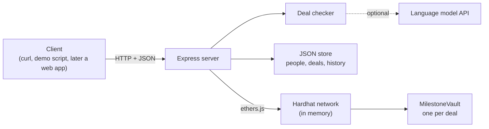
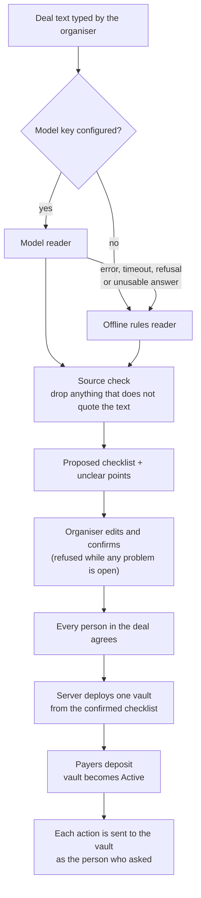
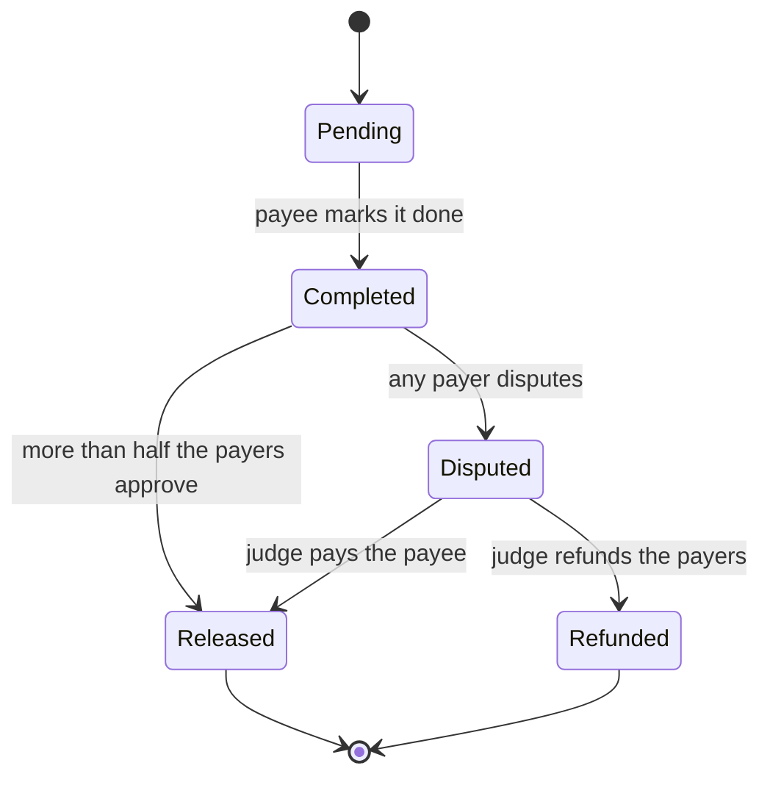

# Settl

**Turn a deal written in plain words into a locked agreement.** People join, money is locked in a smart contract, and each person is paid only when their stage is approved.

Built for VORTEXA 3.0, problem **B-03 MilestoneVault: Adversarial Smart-Contract Escrow**.

> All funds in this project are simulated. Nothing here moves real money or connects to a real payment system.

## Contents

- [The problem](#the-problem)
- [What Settl does](#what-settl-does)
- [Who can use it](#who-can-use-it)
- [Architecture](#architecture)
- [The vault contract](#the-vault-contract)
- [The deal checker (the AI part)](#the-deal-checker-the-ai-part)
- [The server](#the-server)
- [Wallets and real users](#wallets-and-real-users)
- [Project layout](#project-layout)
- [Tech stack](#tech-stack)
- [How to run it](#how-to-run-it)
- [Build status](#build-status)
- [Limits](#limits)
- [Roadmap](#roadmap)

## The problem

When work is paid in stages, both sides are afraid to go first. The payer fears losing the money, and the worker fears not being paid. Three things make it worse:

1. **The middleman is a black box.** Whoever holds the money sets hidden rules and can delay or favour one side.
2. **Agreements are vague.** A line like "pay when the work is good" becomes a dispute later.
3. **A program that holds money cannot make mistakes.** A payment released twice, the wrong person triggering a refund, or a re-entrant call can lose the money for good.

## What Settl does

1. **Describe.** One person, the organiser, types the deal in normal language.
2. **Check.** The deal checker turns the text into a checklist of who pays, who gets paid, who judges, the stages and the amounts. It marks every unclear line, and the organiser fixes them.
3. **Join.** The organiser adds the people. Each person reads the checklist and agrees, and the payers deposit their share. The deal is now locked.
4. **Do and approve.** The person responsible marks a stage done. The payers approve and that person is paid, or a payer disputes and the judge chooses "pay" or "refund".
5. **Finish.** Every stage is settled, the money adds up exactly, and the full history is visible.

Three roles cover every deal:

| Role | What they do |
|---|---|
| **Payers** | Put money in. There can be one or several, each with a share. |
| **Payees** | Get paid, one per stage. One person can be the payee of several stages. |
| **Judge** | Settles disputes. Never a payer or a payee, and can never take the money. |

These map directly onto the brief: the payers are the **client**, the payees are the **provider**, and the judge is the **arbiter**. A deal with one payer and one payee is exactly the case the brief describes.

## Who can use it

The contract only knows payers, payees, a judge and a list of stages, so the same code runs very different deals.

| Deal | Payers | Payees | Stages |
|---|---|---|---|
| Flatmates sharing wifi for a year | Three flatmates | The wifi provider | 12 monthly stages |
| Freelance work | The client | The freelancer | Design, development, launch |
| House construction | The owner | Mason, plumber, electrician | One per trade |
| Company bonus or project payout | The company | Employees | Project stages, one per person |
| Home repair with a stake | The owner | A tradesperson who stakes ₹5,000 | Two stages; the stake is lost by walking away |

A sample of each is in [server/fixtures/](server/fixtures/).

## Architecture

### Components



| Component | Job | Where |
|---|---|---|
| Vault contract | Holds the money and enforces every rule about who may do what, and when | [contracts/MilestoneVault.sol](contracts/MilestoneVault.sol) |
| Deal checker | Reads deal text into a proposed checklist, with a model path and an offline path | [server/src/checker/](server/src/checker/) |
| Server | Stores deals and people, runs the agree step, deploys a vault from a confirmed checklist, forwards actions to the vault | [server/src/](server/src/) |
| Chain | A Hardhat network running inside the server process, with built-in test accounts | [hardhat.config.js](hardhat.config.js) |

### From text to a locked vault



Two design decisions matter most here:

- **The contract is not generated.** One vault contract was written and tested once. Every deal gets a fresh copy of it, filled in with that deal's people and amounts.
- **AI output never reaches the contract directly.** The model only proposes. A person must confirm, every member must agree, and only that confirmed checklist is used to create the vault. A fingerprint of the deal text and the confirmed checklist is stored in the vault, so the vault is tied to exactly what everyone agreed to.

## The vault contract

### Stage path



The vault itself moves through four phases: **Funding** (waiting for every payer's deposit), **Active**, **Cancelled** and **Closed** (every stage settled).

### Actions

| Action | Who | Allowed when | Effect |
|---|---|---|---|
| `deposit()` | A payer | Funding; this payer has not paid; the value equals their share | Records the deposit. The vault becomes Active when every payer has paid and, if a stake is set, every payee has staked |
| `stake()` | A payee | Funding; a stake is set; this payee has not staked; the value equals the stake | Records the stake. It is credited back when the deal closes |
| `cancel()` | A payer | Funding | The vault becomes Cancelled and each deposit and stake is credited back to whoever made it |
| `markComplete(i)` | The payee of stage `i` | Active; stage is Pending | Stage becomes Completed |
| `approve(i)` | A payer, once per stage | Active; stage is Completed | Counts the approval. When more than half the payers have approved, the stage is Released and its amount is credited to the payee |
| `dispute(i)` | A payer | Active; stage is Completed | Stage becomes Disputed |
| `resolve(i, payPayee)` | The judge | Active; stage is Disputed | Released (credit the payee) or Refunded (credit the payers by share) |
| `leave()` | A payee with an unsettled stage | Active; a stake is set; this payee has not left | Their unsettled stages are refunded to the payers, and their stake is credited to the payers by share |
| `withdraw()` | Anyone with credit | Credit above zero | Clears the credit, then sends the money |

Anything else is refused with a named error.

The stake is optional and set per deal; zero switches it off. It gives a payee a reason not to walk away from a locked deal. A forfeited stake goes to the payers, never to the judge, so nobody gains by pushing a payee out.

### How it stays safe

| Guarantee | How the contract does it | Proved by |
|---|---|---|
| No second release | A stage can be settled once. Its state changes before any credit is given | [test/attacks.test.js](test/attacks.test.js) |
| No unauthorised refund | `resolve` checks that the caller is the judge. The judge's only choices are pay or refund, and neither sends money to the judge | [test/attacks.test.js](test/attacks.test.js) |
| No out-of-order step | Every action checks the caller, then the vault phase, then the stage state | [test/attacks.test.js](test/attacks.test.js) |
| No re-entrancy theft | Money leaves through one function only. It clears the credit before sending, and it cannot be re-entered | [test/reentrancy.test.js](test/reentrancy.test.js) |
| Balance always reconciles | `reconciles()` checks that the balance equals deposits minus withdrawals, and also locked money plus owed money | Every test, plus [test/reconcile.test.js](test/reconcile.test.js) |
| Fair group rules | Approval needs more than half the payers; a refund is split by share, with the rounding remainder to the last payer | [test/group.test.js](test/group.test.js) |
| The stake cannot be gamed | It is returned only at the close, a payee who left never gets it back, and `leave` cannot be used twice, by an outsider, or to pull the stake out early | [test/stake.test.js](test/stake.test.js) |

### The re-entrancy demonstration

[contracts/demo/WeakVault.sol](contracts/demo/WeakVault.sol) is the real vault with the two `withdraw` protections removed. It is unsafe on purpose and exists only for comparison. The same attacker, [contracts/demo/ReentrantAttacker.sol](contracts/demo/ReentrantAttacker.sol), is run against both:

| | Real vault | WeakVault |
|---|---|---|
| Owed to the attacker | One stage | One stage |
| Attacker receives | Exactly one stage | Every stage in the vault |
| Honest payee afterwards | Still paid | Cannot be paid |

### Balance check under random actions

[test/reconcile.test.js](test/reconcile.test.js) sends hundreds of random actions at a vault, from the right people and the wrong ones, and checks the books after every single step. The sequence is seeded, so any failure can be replayed.

## The deal checker (the AI part)

The checker turns deal text into this checklist. Amounts are whole rupees.

```json
{
  "title": "Wifi for Flat 12, one year",
  "payers": [{ "name": "Asha", "share": 4800 }],
  "judge": { "name": "Mrs. Kulkarni" },
  "stages": [
    {
      "title": "Month 1",
      "payee": "QuickNet Broadband",
      "amount": 1200,
      "condition": "the three flatmates confirm the wifi worked that month",
      "source": "exact text copied from the deal"
    }
  ],
  "unclear": [{ "issue": "No launch date", "question": "What is the launch date?", "source": "" }],
  "total": 14400,
  "stake": 0,
  "readBy": "model"
}
```

### Two readers, one set of checks

| Reader | When it runs | What it is |
|---|---|---|
| **Model reader** ([model.js](server/src/checker/model.js)) | A model key is configured | A language model fills in the checklist. Claude is used through the official SDK with a fixed JSON schema; Gemini is supported as an alternative |
| **Offline reader** ([rules.js](server/src/checker/rules.js)) | No key, or the model fails in any way | Fixed sentence patterns, no network. It is cautious by design: anything it cannot read becomes an unclear point |

Every result records which reader produced it (`readBy`) and, if the offline reader took over, why.

### What both readers must obey

- **Every stage must quote the deal text.** The quote is matched against the text and replaced by the text's own wording, so what is stored is always an exact piece of the deal. A stray word or comma at the edge of a quote is tolerated; a stage whose quote cannot be found is dropped and reported, never silently kept ([validate.js](server/src/checker/validate.js)).
- **Nothing is invented.** A missing name, amount or judge stays empty and becomes an unclear point with a question.
- **Vague wording is flagged.** Phrases such as "satisfactory", "a reasonable time" or "about ₹20,000" each become an unclear point that quotes the phrase.
- **Shared and repeating payments are expanded.** "Each of four people is paid ₹25,000" becomes four stages, and "₹1,200 every month for 12 months" becomes twelve.

### What stops a checklist being confirmed

A checklist cannot be confirmed while any of these is true:

- the payers' shares, the stage amounts and the total do not all agree;
- a stage has no payee or no amount;
- a quoted source is not in the deal text;
- someone named has not been added as a person;
- the judge is a payer or a payee, or a payee is also a payer;
- any unclear point is still open.

These checks are plain code. The model has no say in them.

### How well the readers do, measured

`npm run score` reads the eight sample deals in [samples/deals/](samples/deals/), which are written in free everyday language, and compares each result with the expected checklist written beside it. Five things are checked per deal: the payers and their shares, the judge, the number of stages, the stage total, and whether a clean deal was left clean and a flawed one flagged.

| Reader | Checks right | Time per deal |
|---|---|---|
| Model reader (Gemini `gemini-3.5-flash-lite`) | 36 of 40 | about 2 seconds |
| Offline reader | 8 of 40 | instant |

This is one run on eight deals, so treat it as an indication, and expect the model's figure to move a little between runs. It shows what each reader is for. The model reads ordinary writing. The offline reader only understands a fixed set of sentence shapes, such as those in [server/fixtures/](server/fixtures/), which it reads fully; on anything else it reports that it could not read the line instead of guessing. It keeps the product working without a model, with less reading ability.

## The server

`npm start` runs the Express server with the Hardhat network inside the same process, so one command starts everything. Each fictional person is mapped to one of the chain's built-in accounts, and every request names the acting `person`.

After a deal is locked, the server does not decide whether an action is allowed. It sends the transaction as that person and reports what the contract said. A refusal comes back as HTTP 409 with a plain-language reason.

Stage numbers in the API count from 1.

| Route | Purpose |
|---|---|
| `GET /health` | Server and chain are up |
| `GET /people`, `POST /people` | List or add fictional people. A neutral "Platform Mediator" exists by default and can be used as the judge |
| `POST /deals/draft` | Deal text in, proposed checklist and problem list out |
| `PUT /deals/:id/checklist` | The organiser edits the checklist. Any edit clears earlier agreements |
| `POST /deals/:id/confirm` | The organiser confirms. Refused while any problem is open |
| `POST /deals/:id/agree` | One member agrees |
| `POST /deals/:id/lock` | Refused until everyone has agreed. Deploys the vault |
| `POST /deals/:id/deposit`, `/cancel`, `/withdraw` | Money actions |
| `POST /deals/:id/stake`, `/leave` | A payee puts in the stake, or walks away from a locked deal |
| `POST /deals/:id/stages/:n/complete`, `/approve`, `/dispute`, `/resolve` | Stage actions. `:n` counts from 1. `resolve` takes `"decision": "pay"` or `"refund"` |
| `GET /deals`, `GET /deals/:id` | Deal list, and one deal with its stage states and balances |
| `GET /deals/:id/history` | Accepted actions and refused attempts |
| `GET /deals/:id/summary` | Final settlement |
| `GET /attacks`, `POST /attacks/:name` | Run `second-release`, `unauthorised-refund`, `out-of-order` or `re-entrancy` on fresh vaults |
| `GET /auth/message`, `POST /auth/sign-in`, `POST /auth/sign-out`, `GET /auth/me` | Wallet sign-in |
| `POST /rpc` | The chain, for wallets |
| `POST /deals/:id/transactions` | A wallet person reports the transaction their wallet sent |
| `GET /contract` | The vault's interface, chain ID and RPC path, for clients that call the vault directly |
| `POST /reset` | Starts again from nothing: a fresh chain, no deals, only the built-in mediator. For demonstrations |

### The dashboard

`npm start` serves the dashboard in [web/](web/) at `http://localhost:3000`. It has a deal list, a four-step wizard (describe, review, agree, lock), a deal screen with the stages and the money bar, a final summary and the attack lab.

- **It works with demo people.** The "Acting as" switch names who is acting, so one person can play every role in front of an audience. "Try anything" shows every button to everyone, so a wrong move can be tried and seen to be refused.
- **Anyone a deal names is added as a demo person** when the deal is drafted, so a deal can be typed with any names.
- **It talks to the server through [server/public/settl-bridge.js](server/public/settl-bridge.js)**, a script the server adds to the page. It translates between the screens' data format and the server's, shows the points an organiser must resolve, and adds the stake and leave actions. Nothing in `web/` has to change for it to work.
- **People who sign in with their own wallet use `/wallet` instead.** The dashboard links to it.

## Wallets and real users

There are two kinds of people.

| Kind | Who they are | How the server knows it is them | Who signs their transactions |
|---|---|---|---|
| **Demo person** | A fictional name added with `POST /people` | It does not. The request just names them | The server, with a built-in chain account it holds for them |
| **Wallet person** | A real person with their own wallet | They sign a one-time message with the wallet, and the server checks the signature against the address | Their own wallet. The server holds no key for them |

Demo people exist so the product can be shown without any set-up. Wallet people are the real thing: nobody can act as one by typing their name, because the server refuses a request that names a wallet person without that person's session.

### What a wallet person does

1. **Signs in.** The wallet signs a short message that proves the address is theirs. It costs nothing and moves no money. A first sign-in also takes their name and gives the wallet pretend funds.
2. **Agrees by signature.** To agree to a deal, they sign a message carrying the deal's fingerprint. The signature is stored with the deal, and anyone can check it against their address. Editing the checklist changes the fingerprint, so old signatures stop fitting and are thrown away.
3. **Sends their own transactions.** For a deposit or a stage action, the server first asks the chain whether the contract would accept it from that address. If not, it answers with the plain reason and the wallet is never opened. If so, it hands back the transaction, and the person's wallet signs and sends it.

A wallet can also call the vault directly without asking the server. The contract's rules apply either way, and the deal's state is always read from the chain.

### How the wallet reaches the chain

The chain runs inside the server, so the server passes wallet requests through at `POST /rpc`, and `npm start` also offers the same chain at `http://localhost:8545`. Only what a wallet needs is let through: reading the chain and sending transactions the wallet has already signed. Requests that would make the node sign with the demo accounts' keys, or rewrite the chain, are refused.

| Wallet network setting | Value |
|---|---|
| RPC URL | `http://localhost:3000/rpc` or `http://localhost:8545` |
| Chain ID | `31337` |
| Currency symbol | `ETH` |

Money is pretend: ₹1,000 is shown as 1 test ETH, so a ₹30,000 deposit appears in the wallet as 30 ETH.

### Trying it with MetaMask

1. Run `npm start` and open `http://localhost:3000/wallet`.
2. Click **Connect wallet**. The page asks MetaMask to add and switch to the local network. Use a fresh account with no real funds.
3. Enter a name and click **Sign in with wallet**.
4. Have the other people in the deal do the same from their own browsers or MetaMask accounts. The names they sign in with must match the names in the deal text.
5. Write a deal, then confirm, agree, lock, deposit and work through the stages.

Restarting the server resets the chain. If transactions then fail, use MetaMask → Settings → Advanced → "Clear activity tab data".

Set `REQUIRE_WALLET=true` to switch demo people off entirely, so every action needs a wallet session.

**What has been tested:** the whole flow, with real keys signing real transactions through `/rpc`, in [server/test/wallet.test.js](server/test/wallet.test.js). **What has not:** the page has not yet been driven by MetaMask itself.

## Project layout

```
contracts/
  MilestoneVault.sol          the vault
  demo/WeakVault.sol          unsafe copy, for the re-entrancy comparison only
  demo/ReentrantAttacker.sol  the attacker used by tests and the attack demo
test/                         contract tests
  setup.test.js               what the vault refuses at creation
  lifecycle.test.js           payment, dispute-release and dispute-refund paths
  attacks.test.js             second release, unauthorised refund, out-of-order steps
  reentrancy.test.js          the same attacker against both vaults
  group.test.js               several payers: funding, majority approval, refund split
  stake.test.js               the optional stake: funding, return, leaving, cheat attempts
  reconcile.test.js           random actions with the balance checked after each
server/
  src/app.js, index.js        the API and its entry point
  src/store.js                JSON file store
  src/people.js               demo people (server-held accounts) and wallet people
  src/auth.js                 wallet sign-in and sessions
  src/rpc.js                  the chain, passed through for wallets
  src/chain.js                deploy, act, read state, plain-language refusal reasons
  src/deals.js                deal routes
  src/attacks.js              the attack lab
  src/checker/                model.js, rules.js, validate.js, index.js
  public/settl-bridge.js      connects the dashboard in web/ to this server
  fixtures/                   five sample deals
  test/                       checker tests, API tests and wallet tests
web/                          the dashboard, served at /
wallet/index.html             the wallet console, served at /wallet
scripts/demo.js               end-to-end run of five deals and four attacks
scripts/score.js              scores the deal checker against the sample deals
samples/                      more sample deals with their expected checklists
hardhat.config.js, package.json, .env.example
```

## Tech stack

| Part | Tools |
|---|---|
| Contract | Solidity 0.8.28, OpenZeppelin `ReentrancyGuard` |
| Local chain and contract tests | Hardhat, ethers.js, Mocha and Chai |
| Server | Node.js, Express |
| Deal checker | Anthropic SDK for the model path, plain JavaScript for the offline path |
| Server tests | Node's built-in test runner |
| Storage | One JSON file, rewritten on each start |

Everything except the contract is JavaScript.

## How to run it

You need Node.js 22 or newer. The first compile downloads the Solidity compiler, so be online for that step.

```
npm install
npm test
npm run demo
npm start
```

| Command | What it does |
|---|---|
| `npm test` | Compiles the contracts and runs every contract test and server test |
| `npm run test:contract` | Contract tests only |
| `npm run test:server` | Server tests only |
| `npm run demo` | Runs five deals from plain text to final payout through the API, then the four attacks, printing each step. Exits with an error if any step differs from what it states |
| `npm run score` | Scores the deal checker against the sample deals in `samples/deals/` |
| `npm start` | Starts the server and the dashboard at `http://localhost:3000`, and the wallet console at `/wallet` |

### What the demo shows

`npm run demo` needs no key and no set-up, and gives the same result every time.

| Part | What happens |
|---|---|
| Freelance website | One payer, one payee, one judge: the case in the brief. Wrong moves are tried at each step and refused |
| Flatmates sharing wifi | Three payers. The deal starts only when all three have paid, and a stage is released on two approvals out of three |
| House construction | Three trades. One dispute is settled for the payee and one for the payer; nobody but the judge can settle either |
| Company bonus | One payer and four employees, with one stage per person |
| Kitchen retiling with a stake | The deal starts only once the payee has staked. The payee then walks away: the unfinished stage is refunded and the stake goes to the payer |
| Attack lab | Second release, unauthorised refund, out-of-order steps, and re-entrancy against both the real vault and the weak copy |
| Model reader | Only when a key is set: reads one deal with the model and reports what came back |

### Trying it by hand

With the server running (in PowerShell, type `curl.exe` in place of `curl`):

```
curl -X POST localhost:3000/people -H "content-type: application/json" -d "{\"names\":[\"Riya\",\"Aman\",\"Meera\"]}"
curl -X POST localhost:3000/deals/draft -H "content-type: application/json" -d "{\"person\":\"Riya\",\"text\":\"Riya pays Rs 30000 for a website. Aman is paid Rs 30000 when the site is live. Meera settles any dispute.\"}"
curl -X POST localhost:3000/deals/deal-1/confirm -H "content-type: application/json" -d "{\"person\":\"Riya\"}"
curl -X POST localhost:3000/attacks/re-entrancy
```

### Configuration

Copy `.env.example` to `.env` and put your values in `.env`. Every value is optional. Never put a real key in `.env.example`: that file is committed, while `.env` is ignored by git.

| Variable | Meaning |
|---|---|
| `ANTHROPIC_API_KEY` | If set, the deal checker reads deals with Claude |
| `GEMINI_API_KEY` | Used when no Anthropic key is set. Needs `LLM_MODEL` |
| `LLM_MODEL` | Model name for the chosen provider. Defaults to `claude-opus-5-5` for Claude |
| `CHECKER_MODE` | Set to `rules` to force the offline reader even when a key is present |
| `REQUIRE_WALLET` | Set to `true` to allow wallet people only. Demo people are switched off |
| `PORT` | Server port. Defaults to 3000 |
| `RPC_PORT` | Second port where wallets can reach the chain. Defaults to 8545 |

With no key, the offline reader is used and everything else works the same.

## Build status

| Part | Status |
|---|---|
| Vault contract, including the optional stake | Done. 81 contract tests pass |
| Attack tests and the WeakVault comparison | Done |
| Deal checker: offline reader, validation, fallback | Done. 34 tests pass |
| Deal checker: model reader | Done. Run against Gemini (`gemini-3.5-flash-lite`): see the measured figures above. The Claude path has not been run against a live key |
| Server: every route in the table above | Done. 27 API tests pass |
| Wallet sign-in, signed agreements, wallet-sent transactions | Done. 31 tests pass, using real keys through `/rpc` |
| Wallet console page (`/wallet`) | Written. Its logic passes a scripted run with a stand-in wallet; not yet tried with MetaMask |
| End-to-end demo (`npm run demo`) | Done. Five deals and four attacks, with every step checked |
| Dashboard (`/`) | Connected to the server. A full deal, the stake flow, the summary, the attack lab and reset were run through the real page in a headless browser environment; not yet checked by eye in a real browser |

## Limits

- **All money is simulated.** There is no real UPI or bank connection.
- **"Locked in" covers only money already deposited.** A contract cannot take money from someone later, so payers deposit their full share at the start.
- **It cannot force anyone to do the work.** It controls only when money moves. The optional stake gives a payee a reason to finish, nothing more.
- **There are no deadlines.** If a payee never marks a stage done and never leaves, that stage's money stays locked. A time limit after which the payers can reclaim it is planned.
- **People still decide.** A person approves the work and a person judges a dispute. Settl does not decide whether work is good.
- **It does not replace a legal contract.**
- **Demo people have no login.** The server acts as whichever demo person a request names. Wallet people are authenticated by signature and sign their own transactions; `REQUIRE_WALLET=true` allows only them.
- **A session is a token held in memory.** It ends when the server restarts, and it is not tied to a browser or device.
- **The chain lives in memory.** Restarting the server clears every deal and vault.
- **The offline reader understands a limited set of sentence shapes.** Text outside them is reported as unclear, not guessed at.
- **`reconciles()` uses strict equality.** Ether forced into the vault from outside its functions would make it report false. No money can be taken out that way.

## Roadmap

| Level | Who uses it | What gets added |
|---|---|---|
| 1. Small group | A few payers, payees and one judge | This project |
| 2. Small business | One firm running many deals | This project: a new vault per deal |
| 3. Company | Teams in place of single people | Approval by several managers; a panel of judges deciding by majority |
| 4. Large enterprise | A main contractor with many subcontractors | Vaults that pay into other vaults, an inspector's sign-off as a condition, links to company accounts |

Also planned: a deadline per stage, monthly payments backed by the stake in place of a full deposit up front, and real rupee payments through a licensed payment partner.
